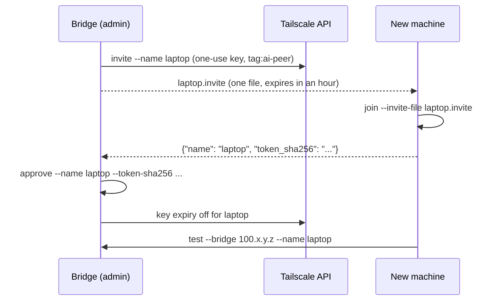

# Onboarding a machine

How to add a machine to an AI-Connect tailnet, take one off, rotate what it holds, and
fix what goes wrong. Every command is `deploy/deploy.sh` on Linux and macOS and
`deploy\deploy.ps1` on Windows, with the same arguments and the same output. Run them
from the plugin's directory (`plugin/ai-connect`). Each one can be run again: a step
that is already done says `already done` and changes nothing. Add `--dry-run` to see
every step first; it runs no tool and changes nothing.

This assumes the Bridge exists: `deploy tailnet-setup --apply` and `deploy bridge` have
run on it once ([the runbook](README.md)). The Bridge is also the admin machine: it holds
the OAuth client that mints join keys.



## Add a machine in three steps

**1. On the Bridge**, make an invite for the new machine:

```bash
deploy/deploy.sh invite --name laptop --out laptop.invite
```

```powershell
deploy\deploy.ps1 invite --name laptop --out laptop.invite
```

The invite holds a Tailscale auth key that works once, is pre-approved, is tagged
`tag:ai-peer`, and expires after an hour (`--expiry 30m`, `1d`, ...). It is written
owner-only. It is **not ephemeral**: every machine joined is trusted and stays in the
tailnet through a sleep, a reboot or a long time offline. `--ephemeral` is for throwaway
and CI machines only. Without `--out` the invite is shown once, to copy.

Carry `laptop.invite` to the new machine (a USB stick, `scp`, a password manager). Treat
it as a secret until it is used or has expired.

**2. On the new machine**, join:

```bash
deploy/deploy.sh join --invite-file laptop.invite
```

```powershell
deploy\deploy.ps1 join --invite-file laptop.invite
```

Run it as the user whose Claude Code sessions will use AI-Connect, not under `sudo`: the
config and the token go to that user's home, and `sudo` (or UAC on Windows) is asked for
only where Tailscale needs it. It checks for other VPNs, installs Tailscale if it is missing, joins the tailnet with the
invite's key, deletes the used invite file, makes this machine's own token (owner-only, in
`~/.config/ai-connect/own-peer.token`), writes the client config, and prints:

```
{"name": "laptop", "token_sha256": "3f1c..."}
  The token stays here. On the Bridge: deploy approve --name laptop --token-sha256 3f1c...

  CHECK                      RESULT   DETAIL
  VPN up                     PASS     Tailscale is running, this machine is 100.x.y.z
  Bridge port reachable      PASS     100.x.y.z:9999 accepts TCP connections
  Bridge accepts this token  PENDING  not approved yet: on the Bridge run deploy approve ...
```

To paste the invite instead of carrying a file: `deploy join --invite`, which asks for
it without showing it. Automation can set `AI_CONNECT_INVITE` from its secret store. The
invite never goes on a command line, where any user could read it in the process list. Claude Code gets nothing by default; `--register-mcp` adds the MCP server
and `--with-hooks` the plugin's hooks for every session on the machine. Each prints a
warning: in a bypass-permissions session, what another peer sends is acted on with no
prompt in between. The peer-state hooks (busy / idle / waiting) need both: they call the
MCP server, so `join` writes them only with both options, into the settings of the scope
the server is registered in (`deploy/README.md`).

**3. On the Bridge**, approve with the hash the new machine printed:

```bash
deploy/deploy.sh approve --name laptop --token-sha256 3f1c...
```

It lets the token in, restarts the Bridge, and turns the node's key expiry off. Then, on
the new machine, the end-to-end check:

```bash
deploy/deploy.sh test --bridge 100.x.y.z --name laptop
```

Only the hash crosses machines: the token itself never leaves the new machine.

### Without an invite

`deploy join --name legion --bridge 100.x.y.z` logs the machine in through the browser
instead (the URL is printed when there is no browser) and asks for `tag:ai-peer`. The
account that signs in must be allowed to apply that tag: `deploy tailnet-setup --apply`
makes the tailnet's admins its owners. A node that joined by a login keeps an expiring
key even once tagged; `deploy approve` on the Bridge turns that off.

### Why an invite, and not a key encrypted to the new machine

An encrypted hand-off needs a second paste (the new machine's public key to the admin)
and asymmetric crypto that Python's standard library does not have. The invite is
already narrow: it works once, expires in an hour, and a machine that joins with it
reaches only TCP 9999 on the Bridge, which refuses its token until `deploy approve`. A
stolen invite that is used first shows up in `deploy list` as a node with no approved
peer; remove it with `deploy remove`.

## See what is there

```bash
deploy/deploy.sh list      # on the Bridge: every node, its IP, tags, online state, key expiry, and Bridge peer
deploy/deploy.sh status    # on any machine: what is deployed here, and whether this node's key expires
```

`list` ends with a line naming every node whose key still expires. The Tailscale API
reports no ephemeral flag, so `list` cannot show one.

## Remove a machine

```bash
deploy/deploy.sh remove --name laptop --yes
```

It deletes the `tag:ai-peer` node from the tailnet, takes the peer out of the Bridge's
`config.yaml`, deletes its token file if the Bridge made one, and restarts the Bridge. It
refuses the Bridge's own peer. On the removed machine itself, `deploy uninstall --yes
--purge` deletes its config, token and installed copy.

## Rotate

- **A peer's token**: `deploy remove --name laptop --yes` on the Bridge; on the machine,
  delete `~/.config/ai-connect/own-peer.token`; then invite, join and approve again.
- **A join key**: there is nothing to rotate. Each invite works once and expires; one
  that was never used expires by itself.
- **The OAuth client** the Bridge mints with: delete it in the admin console (Settings,
  OAuth clients), then `deploy tailnet-setup --apply` creates and stores a new one.

## Troubleshooting

| What you see | Why, and what to do |
|---|---|
| `not an ai-connect invite` | The file holds something else, or was cut short. Make a new invite. |
| `vpn-up failed`, Tailscale says the key is invalid or expired | The invite was used already, or expired. Make a new one. |
| `tailscale up failed ... tagOwners` | Joined by a login with an account that may not apply `tag:ai-peer`. Use an invite, or run `deploy tailnet-setup --apply`. |
| `Bridge accepts this token PENDING` | Not approved yet: run the `deploy approve` line `join` printed, on the Bridge. |
| `Bridge port reachable FAIL` | The Bridge is down (`deploy status` there), or the tailnet policy does not let `tag:ai-peer` reach `tag:bridge:9999`. |
| `node key: EXPIRES` in `status`, or a name in `list`'s last line | Run `deploy approve --name <it>` on the Bridge (`deploy bridge` for the Bridge itself). |
| `not root and no sudo` | Run `join` as root, or install `sudo`. |
| A route inside `100.64.0.0/10` stops `join` | Another VPN claims Tailscale's addresses; see below. |

## Running alongside other VPNs

`join` never takes routes, an exit node or DNS from the tailnet
(`--accept-routes=false --exit-node= --accept-dns=false`), so a corporate VPN client on the
same machine keeps its routes and resolver. Before it touches Tailscale it lists the other
VPN interfaces that are up; a route inside `100.64.0.0/10` or `fd7a:115c:a1e0::/48` stops it
until that VPN is disconnected or narrowed. `--accept-dns` turns MagicDNS on when you want
it. The details are in the runbook: [Running alongside other VPNs](README.md#running-alongside-other-vpns).
