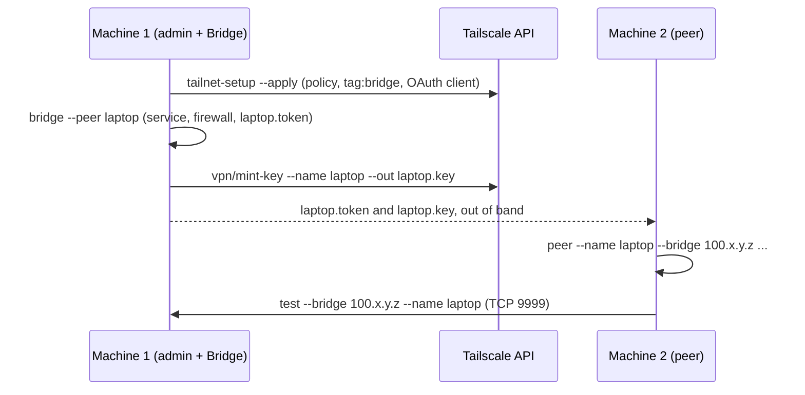

# AI-Connect deploy runbook

Two machines, start to finish: machine 1 is the admin's and runs the Bridge, machine 2
is a peer. Every command below is `deploy.sh` on Linux and macOS and `deploy.ps1` on
Windows, with the same arguments, the same steps and the same output. Each one can be
run again at any time: a step that is already done says `already done` and changes
nothing.



## What you need

- Python 3.10 or newer on both machines, and this plugin's directory (`plugin/ai-connect`).
- A Tailscale account that may edit the tailnet's policy file.
- A Tailscale **API access token**: admin console, Settings, Keys, Generate access
  token. It is used once, by `tailnet-setup`, and stored nowhere. Revoke it afterwards.
- Linux Bridge: `sudo`. Windows Bridge: an elevated PowerShell.

Tailscale itself does not have to be installed: `tailnet-setup`, `bridge` and `peer`
install it when it is missing and say what is about to ask for you (sudo's password, a
UAC prompt, a browser login).

## Machine 1: the tailnet (admin, once)

Preview first. Nothing changes without `--apply`.

```bash
export TS_API_TOKEN=tskey-api-...          # PowerShell: $env:TS_API_TOKEN = 'tskey-api-...'
deploy/deploy.sh tailnet-setup
```

Read the diff it prints. **`--apply` replaces the whole tailnet policy** with
`vpn/acl-template.hujson`: a tailnet that already has rules of its own loses them.
In that case merge the template into your policy by hand, save the result as a file,
and pass it with `--acl FILE`. `--admin you@example.com` names who owns the tags and
keeps access to the Bridge (default: `autogroup:admin`).

```bash
deploy/deploy.sh tailnet-setup --apply
unset TS_API_TOKEN                         # PowerShell: Remove-Item Env:TS_API_TOKEN
```

What `--apply` does, in this order:

1. Installs Tailscale if it is missing and logs this machine in (browser).
2. Has Tailscale validate the policy file and run its `tests` block.
3. Writes the current policy to `~/.config/ai-connect/acl-backups/policy-<time>.hujson`,
   then replaces it. If someone else changed the policy in between, nothing is applied.
4. Tags this machine `tag:bridge`. After that the machine belongs to the tag, not to
   your user; the policy's second grant keeps your access to it.
5. Creates the OAuth client `vpn/mint-key` and `vpn/revoke` use and stores it in the OS
   credential store (Python `keyring`). Without `keyring` it goes to the owner-only file
   `~/.config/ai-connect/tailscale-oauth.json`; `pip install keyring` and a rerun move it.

If the API refuses step 5, the command prints the admin-console steps. Create the
client there, then run `tailnet-setup --apply` again with `TS_OAUTH_CLIENT_ID` and
`TS_OAUTH_CLIENT_SECRET` set, or in a terminal to be asked for them.

To undo the policy change, paste the backup file into Access controls in the admin
console.

## Machine 1: the Bridge

```bash
deploy/deploy.sh bridge --peer laptop      # one --peer per machine that will join
```

It prints this machine's Tailscale IPv4 (the `100.x.y.z` every peer needs) and writes
the peer's token to `~/.config/ai-connect/peer-tokens/laptop.token`. Then mint the
peer's one-off Tailscale key:

```bash
vpn/mint-key.sh --name laptop --out laptop.key      # vpn\mint-key.ps1 on Windows
```

Bring `laptop.token` and `laptop.key` to machine 2 over a channel you trust. The key
works once and expires after a day; the token is that peer's password for the Bridge.

## Machine 2: the peer

```bash
deploy/deploy.sh peer --name laptop --bridge 100.x.y.z --token-file laptop.token --auth-key-file laptop.key
```

It installs Tailscale if needed, joins the tailnet with the key (no browser, no Tailscale
account), deletes the used key file, registers the plugin and the MCP server with
Claude Code, writes the client config and checks that the Bridge accepts the token.

## The test

On machine 2, before a Claude Code session is started there:

```bash
deploy/deploy.sh test --bridge 100.x.y.z --name laptop
```

```
  CHECK                                RESULT  DETAIL
  VPN up                               PASS    Tailscale is running, this machine is 100.x.y.z
  Bridge port reachable                PASS    100.x.y.z:9999 accepts TCP connections
  Bridge accepts this token            PASS    ws://100.x.y.z:9999 accepted this machine's token
  Message round trip, untrusted frame  PASS    a message to 'laptop' came back inside the untrusted frame
  Wrong token refused                  PASS    a random token was refused (HTTP 401)

5 of 5 checks passed
```

The exit code is 1 when any line says `FAIL`. What each failure means:

| Line | Usual cause |
|---|---|
| VPN up | Tailscale is stopped or logged out here: run `deploy peer` again |
| Bridge port reachable | wrong `--bridge`, the Bridge service is down (`deploy status` on machine 1), or the policy does not allow `tag:ai-peer` to reach `tag:bridge:9999` |
| Bridge accepts this token | the token file is not the one `deploy bridge --peer laptop` wrote |
| Message round trip | `name_taken`: a session is already online as this peer, close it. `name_not_bound_to_token`: `--name` is not the name the token was made for |
| Wrong token refused | the Bridge takes any token: do not use it until `auth` in its `config.yaml` is fixed |

The test leaves one message in the peer's own history on the Bridge and one refused
token in the Bridge's log.

## Afterwards

```bash
deploy/deploy.sh status                    # either machine: what is deployed here
deploy/deploy.sh bridge --peer desk        # machine 1: add another peer, then mint its key
vpn/revoke.sh --name laptop                # machine 1: remove a peer's node from the tailnet
deploy/deploy.sh uninstall --yes           # either machine; --purge also deletes config and tokens
```

`bridge`, `peer` and `uninstall` take `--dry-run`, which prints `would: ...` for each
change and makes none.

## Tests

`tests/test_ops_deploy.py` and `tests/test_ops_tailnet.py` run every subcommand against
fakes: a fake Tailscale API on a loopback port, fake system tools on a minimal `PATH`, a
fake credential store, and the real Bridge server on a loopback port for `deploy test`.
No test calls Tailscale or installs anything.
