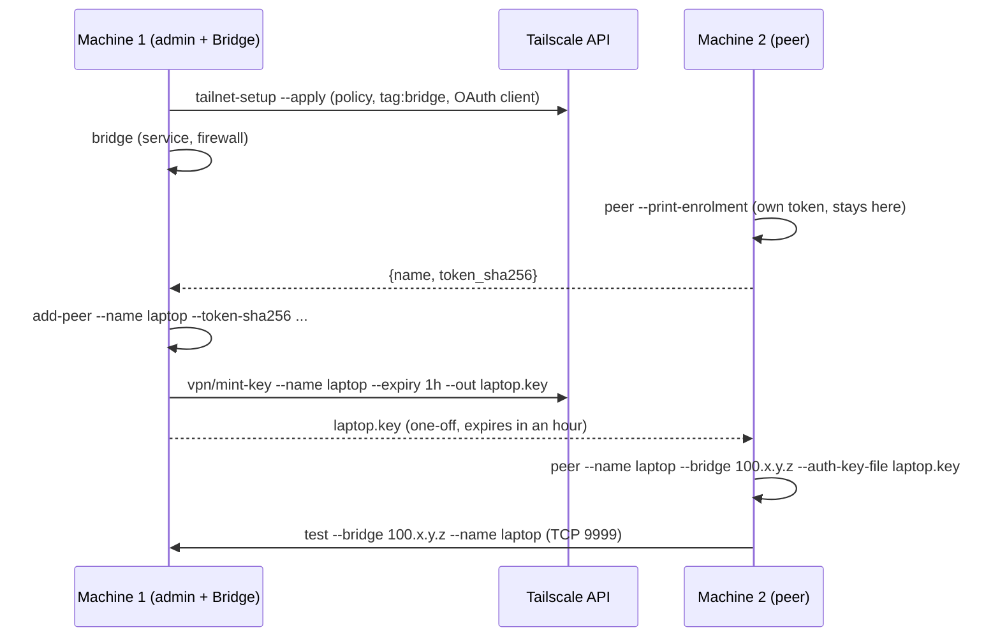

# AI-Connect deploy runbook

Two machines, start to finish: machine 1 is the admin's and runs the Bridge, machine 2
is a peer. Every command below is `deploy.sh` on Linux and macOS and `deploy.ps1` on
Windows, with the same arguments, the same steps and the same output. Each one can be
run again at any time: a step that is already done says `already done` and changes
nothing.



## What you need

- Python 3.10 or newer on both machines, and this plugin's directory (`plugin/ai-connect`).
- A Tailscale account that may edit the tailnet's policy file.
- A Tailscale **API access token**: admin console, Settings, Keys, Generate access
  token. It is used once, by `tailnet-setup`, and stored nowhere. Revoke it afterwards.
- Linux Bridge: `sudo`. Windows Bridge: an elevated PowerShell.

Tailscale itself does not have to be installed: `tailnet-setup`, `bridge` and `peer`
install it when it is missing. On Debian and Ubuntu that is Tailscale's apt repository
with its key in a `signed-by` keyring; elsewhere on Linux, and for a release the
repository does not carry, Tailscale's install script; any other apt failure (a held
dpkg lock, no network) stops instead of falling back. Every command is printed before
it runs, as root nothing goes through `sudo`, and deploy says what is about to ask for
you (sudo's password, a UAC prompt, a browser login).

Tailscale takes no routes, no exit node and no DNS on either machine, so a VPN client
that is already there keeps working: see [Running alongside other VPNs](#running-alongside-other-vpns).
Use the Bridge's `100.x.y.z` address, not its name.

**See everything first.** `bridge`, `peer`, `add-peer` and `uninstall` take `--dry-run`:
it runs no tool at all (no `tailscale`, `claude`, `sudo`, `ufw`), needs no token or key
file, prints every step it may change, and changes nothing. `tailnet-setup` without
`--apply` is its preview: it asks Tailscale and its API, and changes nothing.

## Running alongside other VPNs

Every `tailscale up` deploy runs passes `--accept-routes=false --exit-node= --accept-dns=false`,
and never `--advertise-routes` or `--advertise-exit-node`. A peer's join adds
`--advertise-tags=tag:ai-peer --hostname=<--name>` and reads the key from an owner-only file
(`--auth-key=file:...`). A machine already on the tailnet with other settings is set the
same way with `tailscale set`. `--accept-dns` turns MagicDNS on; nothing turns routes on.

Before Tailscale is touched, `bridge`, `peer` and `vpn/vpn-up` list the other VPN interfaces
that are up and their routes, and print one line:

```
vpn-coexistence: {"other_vpns":[{"name":"AWS Client VPN TAP-Windows Adapter V9 #1","routes":["10.5.0.0/16"]}],"tailscale_takes":{"routes":false,"exit_node":false,"dns":false}}
```

A route inside `100.64.0.0/10` or `fd7a:115c:a1e0::/48` stops the command before anything
changes: disconnect that VPN or narrow its routes, then run it again. A default route or a
full tunnel's `0.0.0.0/1` is wider than Tailscale's own routes and loses to them, so it is
fine. `other_vpns_unknown` in the line means the list could not be read.

`deploy status` shows `RouteAll`, `ExitNode` and `CorpDNS` and flags any that is on. To
fix one by hand: `tailscale set --accept-routes=false --exit-node= --accept-dns=false`.

## Machine 1: the tailnet (admin, once)

Preview first. Nothing changes without `--apply`.

```bash
export TS_API_TOKEN=tskey-api-...          # PowerShell: $env:TS_API_TOKEN = 'tskey-api-...'
deploy/deploy.sh tailnet-setup
```

Read the diff it prints. **`--apply` replaces the whole tailnet policy** with
`vpn/acl-template.hujson`: a tailnet that already has rules of its own loses them.
In that case merge the template into your policy by hand, save the result as a file,
and pass it with `--acl FILE`. `--admin you@example.com` names who owns the tags and
keeps access to the Bridge (default: `autogroup:admin`).

```bash
deploy/deploy.sh tailnet-setup --apply     # asks before it replaces the policy
unset TS_API_TOKEN                         # PowerShell: Remove-Item Env:TS_API_TOKEN
```

Without a terminal (an agent, a script) nothing is ever asked: give the token in
`TS_API_TOKEN` or the OS credential store (`keyring set ai-connect-tailscale api_token`)
and confirm with `--yes`. `--json` prints one JSON object on stdout, with each step and
its result and no secret in it, and sends the text to stderr:

```bash
deploy/deploy.sh tailnet-setup --apply --yes --json
```

What `--apply` does, in this order:

1. Installs Tailscale if it is missing and logs this machine in (browser).
2. Has Tailscale validate the policy file and run its `tests` block.
3. Writes the current policy to `~/.config/ai-connect/acl-backups/policy-<time>.hujson`,
   then replaces it. If someone else changed the policy in between, nothing is applied.
4. Tags this machine `tag:bridge`. After that the machine belongs to the tag, not to
   your user; the policy's second grant keeps your access to it.
5. Creates the OAuth client `vpn/mint-key` and `vpn/revoke` use and stores it in the OS
   credential store (Python `keyring`). Without `keyring` it goes to the owner-only file
   `~/.config/ai-connect/tailscale-oauth.json`; `pip install keyring` and a rerun move it.

If the API refuses step 5, the command prints the admin-console steps. Create the
client there, then run `tailnet-setup --apply` again with `TS_OAUTH_CLIENT_ID` and
`TS_OAUTH_CLIENT_SECRET` set, or in a terminal to be asked for them.

To undo the policy change, paste the backup file into Access controls in the admin
console.

## Machine 1: the Bridge

```bash
deploy/deploy.sh bridge
```

It prints this machine's Tailscale IPv4: the `100.x.y.z` every peer needs.

What keeps running is installed outside the checkout: a copy of the plugin in
`~/.local/share/ai-connect/app` (Windows: `%LOCALAPPDATA%\ai-connect\app`) and its venv
in `.../ai-connect/venv`. The service and the MCP server run from there, so the checkout
you ran deploy from can be deleted. To update, run the same command from a newer
checkout: it copies what changed and restarts the Bridge. A Bridge an older deploy set
up from inside a worktree is moved the same way: its scheduled task is registered again.

## Adding the peer: no long-lived secret crosses machines

The short way is three commands, `invite`, `join` and `approve`:
[ONBOARDING.md](ONBOARDING.md). The steps below are the same flow by hand.

**Machine 2** makes its own token and prints only its hash:

```bash
deploy/deploy.sh peer --name laptop --bridge 100.x.y.z --print-enrolment
# {"name": "laptop", "token_sha256": "3f1c..."}
```

The token stays on machine 2, owner-only, in `~/.config/ai-connect/own-peer.token`.
Send the one JSON line to machine 1. It is not a secret.

**Machine 1** lets the peer in by that hash and mints its one-off Tailscale key:

```bash
deploy/deploy.sh add-peer --name laptop --token-sha256 3f1c...
vpn/mint-key.sh --name laptop --expiry 1h --out laptop.key      # vpn\mint-key.ps1 on Windows
```

Send `laptop.key` to machine 2. It works once, is pre-approved, and expires after an
hour if unused. It is **not ephemeral**: every machine joined is trusted, and it stays in
the tailnet. Tagged nodes have node-key expiry disabled, so a joined machine survives a
sleep, a reboot and long offline periods with no new key. `--ephemeral` is opt-in, for
throwaway or CI machines only: Tailscale removes such a node soon after it goes offline.

**Machine 2** joins and connects:

```bash
deploy/deploy.sh peer --name laptop --bridge 100.x.y.z --auth-key-file laptop.key --dry-run   # look first
deploy/deploy.sh peer --name laptop --bridge 100.x.y.z --auth-key-file laptop.key
```

It installs Tailscale if needed, joins the tailnet with the key (no browser, no Tailscale
account), deletes the used key file, writes the client config and checks that the
Bridge accepts the token. It never changes the peer's firewall, and it registers
nothing with Claude Code unless asked: `--register-mcp [--scope project|user]` adds the
MCP server, `--install-hooks` the plugin's hooks for every session on the machine. Each
prints a warning: in a bypass-permissions session, what another peer sends is acted on
with no prompt in between.

The peer-state hooks (busy / idle / waiting) call the MCP server, so they are written only
with both options, into the settings of the scope the server is in: the user's
`~/.claude/settings.json` with `--scope user`, this project's `.claude/settings.local.json`
with `--scope project` (in the user's settings they would fail in every other project,
which has no such server). Other hooks and keys in that file are kept, a file that is not
valid JSON stops the step untouched, and `deploy uninstall` takes them out again from the
user's settings and from the project it is run in. A peer deployed with both options
before 0.1.11 got these hooks from the plugin; after updating the plugin, run the same
`deploy peer` command again to write them.

The older way still works: `deploy bridge --peer laptop` makes the token on the Bridge
and writes `~/.config/ai-connect/peer-tokens/laptop.token`, which then has to be carried
to machine 2 and passed with `--token-file`.

## The test

On machine 2, before a Claude Code session is started there:

```bash
deploy/deploy.sh test --bridge 100.x.y.z --name laptop
```

```
  CHECK                                RESULT  DETAIL
  VPN up                               PASS    Tailscale is running, this machine is 100.x.y.z
  Bridge port reachable                PASS    100.x.y.z:9999 accepts TCP connections
  Bridge accepts this token            PASS    ws://100.x.y.z:9999 accepted this machine's token
  Message round trip, untrusted frame  PASS    a message to 'laptop' came back inside the untrusted frame
  Wrong token refused                  PASS    a random token was refused (HTTP 401)

5 of 5 checks passed
```

The exit code is 1 when any line says `FAIL`. What each failure means:

| Line | Usual cause |
|---|---|
| VPN up | Tailscale is stopped or logged out here: run `deploy peer` again |
| Bridge port reachable | wrong `--bridge`, the Bridge service is down (`deploy status` on machine 1), or the policy does not allow `tag:ai-peer` to reach `tag:bridge:9999` |
| Bridge accepts this token | the hash given to `add-peer` is not this machine's (run `--print-enrolment` again and compare), or the Bridge was not restarted |
| Message round trip | `name_taken`: a 0.1.8 session (or the HTTP/SSE server) is online under the machine's bare name, close it; 0.2.0 sessions register as `<name>:<project>` and leave it free. `name_not_bound_to_token`: `--name` is not the name the token was made for |
| Wrong token refused | the Bridge takes any token: do not use it until `auth` in its `config.yaml` is fixed |

The test leaves one message in the peer's own history on the Bridge and one refused
token in the Bridge's log.

## One run per machine: setup

`deploy/setup.sh` (Linux, macOS for a peer) and `deploy\setup.ps1` (Windows) take a machine
that has the plugin and nothing else to a working peer in one run. Both hand straight to
`deploy/peer_setup.py`, so they take the same options in the same order and print the same
text. It is a thin layer: every change is made by the `deploy` commands above (`bridge`,
`peer`, `join`, `add-peer`), in this process, with their own text.

**Without `--apply` it prints the plan and changes nothing** (it runs no tool at all, like
`--dry-run`). With `--apply` it does the work. Either can be run again; a step that is done
says `already done`.

| Command | What it does |
|---|---|
| `setup bridge [--name N] [--peer P ...] [--enrol NAME=SHA256 ...] [--port N] [--vpn-subnet CIDR]` | `deploy bridge` (venv, Tailscale, config, one token file per `--peer`, the service, the firewall rule, the health check), then `deploy add-peer` for each `--enrol`, then the two checks below, then the lines to run on each peer, for both operating systems |
| `setup peer --name N --bridge IP --token-file F [--auth-key-file F]` | `deploy peer` with the token file the Bridge made (`~/.config/ai-connect/peer-tokens/N.token` there). Run again without the file, it checks the connection and rewrites nothing |
| `setup peer --name N --bridge IP` | `deploy join`: the machine makes its own token and prints `{name, token_sha256}`; the Bridge lets it in with `setup bridge --enrol N=<token_sha256>` |
| `setup peer --invite-file F` | `deploy join` with an invite from `deploy invite` |
| `setup session --name N` | A second peer name on this machine, with its own token: see below |
| `setup session --project DIR [--project DIR ...]` | One peer name per project for `client.name_mode: per-project`, each with its own token and `.dir`; one Bridge restart for all: see below |

`bridge` and `peer` also take `--register-mcp` (off by default; `--scope user`, the
default, or `project`), `--no-install-tailscale` and `--port`. `setup` installs no plugin
hooks.

**What it checks that `deploy` left to the reader**

- **Is the firewall on?** `ufw allow` succeeds on an inactive ufw, and `ufw status` then
  lists no rule at all, so a rule could be reported as done while it filtered nothing, and
  be added again on every run. The firewall step now asks: ufw from `ufw status` (or
  `ENABLED=` in `/etc/ufw/ufw.conf` when ufw answers in another language), firewalld from
  `firewall-cmd --state`, Windows from the Private profile's state
  (`Get-NetFirewallProfile`). It prints `NOT ENFORCED` when the firewall is off and
  `NOT VERIFIED` when it could not tell, repeats that in the summary, and reads the rules
  of an inactive ufw from `ufw show added`. **It never turns a firewall on**: enabling one
  applies its default policy to every port of the machine, an SSH session included. With
  firewalld not running no rule is added, and the deploy goes on to its health check.
  `deploy status` flags a rule that is not enforced, and `deploy uninstall` removes the
  stored rule of an inactive ufw.
- **Has the tailnet policy been set?** `setup` never runs `tailnet-setup`: it needs the
  owner's Tailscale API token, and `--apply` replaces the whole tailnet policy. On the
  Bridge, `setup bridge` reads this machine's tags (`tailscale status`) and looks for the
  stored OAuth client, the two things `tailnet-setup --apply` leaves there, and prints
  `OUTSTANDING` with the commands when either is missing. It does not read the policy
  itself. On a peer, `setup peer` opens one TCP connection to the Bridge's port; a port
  that does not answer is the usual sign of a policy that does not let `tag:ai-peer`
  reach `tag:bridge:9999`.

### A second session on one machine

Since 0.2.0 every session on a machine is online by itself, as `<client.name>:<project>`
(since 0.2.2 `<client.name>:<session name>` for a named Claude Code session) with `client.token`: nothing to set up ([ONBOARDING.md](ONBOARDING.md#several-sessions-on-one-machine)).
Before 0.2.0 they all joined as `client.name`, and a live name cannot be taken over, so a
second session waited on standby. A session that should have a name and a **token of its
own** (one that can be revoked without the machine's) is still made like this:

```bash
deploy/setup.sh session --name laptop-2            # the plan
deploy/setup.sh session --name laptop-2 --apply
AI_CONNECT_PEER_NAME=laptop-2 claude               # PowerShell: $env:AI_CONNECT_PEER_NAME = 'laptop-2'; claude
```

It makes a token for that name, owner-only, in
`~/.config/ai-connect/session-tokens/laptop-2.token`. On the Bridge machine it enrols the
token's hash and restarts the Bridge (every peer that is online is disconnected for a
moment). On any other machine it prints `{name, token_sha256}`, and the Bridge lets it in
with `setup bridge --enrol laptop-2=<token_sha256> --apply`. The client then sends that
token whenever `AI_CONNECT_PEER_NAME` is `laptop-2`, and `client.token` otherwise. Set the
variable for the `claude` command itself, not in the MCP server's registration: the
watcher hook reads it too. To take it back, on the Bridge: `deploy remove --name laptop-2
--yes` (it asks the Tailscale API for a node of that name first, so it needs the stored
OAuth client), or `installer.py revoke-peer laptop-2` and a Bridge restart; then delete the
token file.

### One name per project

With `client.name_mode: per-project` in `config.yaml`, a session joins as
`<client.name>-<project folder name>` (the project is `CLAUDE_PROJECT_DIR`, else the working
directory; the folder name is cut down to letters, digits and single hyphens, the whole
name to 63 characters), so every project on the machine can be online at once:

```bash
deploy/setup.sh session --project ~/src/api --project ~/src/web            # the plan
deploy/setup.sh session --project ~/src/api --project ~/src/web --apply    # laptop-api, laptop-web
```

For each project it writes `session-tokens/<name>.token` (owner-only) and
`session-tokens/<name>.dir`, the project's absolute resolved path on one line (UTF-8, one
trailing `\n`; a reader also takes it without one, or with `\r\n`). On the Bridge machine
every hash is enrolled and the Bridge restarted once; elsewhere one `{name, token_sha256}`
line per name is printed for `setup bridge --enrol`. It refuses two projects with one name,
a name whose `.dir` holds another project, and `Bridge` / `User:...`. A session falls back
to `client.name` and `client.token`, with one line on stderr, when its token is missing,
not a regular file owned by the user with mode 600, or its `.dir` names another directory.
`AI_CONNECT_PEER_NAME` still wins. The details are in the plugin README, "Details".

## Afterwards

```bash
deploy/deploy.sh status                    # either machine: what is deployed here
deploy/deploy.sh list                      # machine 1: every node, its IP, tags, key expiry, and Bridge peer
deploy/deploy.sh approve --name desk --token-sha256 ...    # machine 1: let a peer in, restart, key expiry off
deploy/deploy.sh remove --name laptop --yes                # machine 1: node off the tailnet, peer out of the Bridge
deploy/deploy.sh uninstall --yes           # either machine; --purge also deletes config, tokens and the installed copy
```

`deploy test` is one short Python process: it opens two WebSocket connections and
sends one message. It runs no test suite and installs nothing.

## Tests

`tests/test_ops_deploy.py` and `tests/test_ops_tailnet.py` run every subcommand against
fakes: a fake Tailscale API on a loopback port, fake system tools on a minimal `PATH`, a
fake credential store, and the real Bridge server on a loopback port for `deploy test`.
No test calls Tailscale or installs anything.

`tests/test_ops_setup.py` runs `setup` on the same fake machine: the plan changes nothing
and runs no tool, both roles end to end, a second session whose token the client then
sends, per-project names (the name, each fallback with its one stderr line, the watcher
taking the client's name, and `session --project` with one restart, through `setup.sh`
and `setup.ps1` alike), an inactive ufw, a firewalld that is not running, the Windows profile states, the
outstanding tailnet policy, and `setup.sh` against `setup.ps1` line for line.
