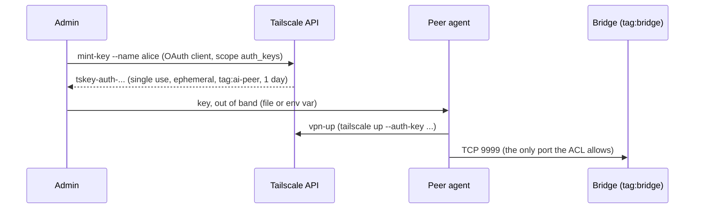

# ai-connect VPN self-join

Agents on other people's machines reach the ai-connect Bridge (TCP 9999) over
Tailscale. An admin mints one single-use key per peer, and the agent joins with it.
The agent never needs a Tailscale account or the admin console.



Every script comes as `.sh` (bash, macOS/Linux/Git Bash) and `.ps1` (PowerShell 7 or
5.1). Both are thin shims over `tsadmin.py`, so they behave the same. Each one needs
Python 3.8+ and uses only the standard library. `keyring` is optional.

## One-time setup (a human, once per tailnet)

1. **Install Tailscale** on the Bridge host and log it in.
2. **Tag the Bridge host**: in the admin console, open Machines, pick the Bridge host,
   choose Edit ACL tags, and add `tag:bridge`. Alternatively, run
   `tailscale up --advertise-tags=tag:bridge` on that host.
3. **Apply the ACL**: merge [`acl-template.hujson`](acl-template.hujson) into Access
   controls and replace `admin@example.com`. Tailscale runs the policy's `tests` block
   on save and refuses the policy if a test fails. The template lets a peer reach
   `tag:bridge:9999` over TCP only. A peer cannot reach other peers, and nothing can
   connect to a peer.
4. **Create an OAuth client**: Settings, then OAuth clients, then Generate. Give it these scopes:
   - `auth_keys` (write), restricted to tag `tag:ai-peer`. This is what `mint-key` uses.
   - `devices:core` (write), restricted to tag `tag:ai-peer`. Only `revoke` needs this scope.
5. **Store the client credentials** on the admin machine. Pick one:
   - environment variables `TS_OAUTH_CLIENT_ID` and `TS_OAUTH_CLIENT_SECRET`, or
   - the OS credential store through Python `keyring`:
     `keyring set ai-connect-tailscale oauth_client_id` and
     `keyring set ai-connect-tailscale oauth_client_secret`. The environment wins if both are set.

## Per peer (automated)

**Admin**: mint one key.

```bash
./mint-key.sh --name alice-laptop                        # prints the key once
./mint-key.sh --name alice-laptop --out alice.key        # or writes it to an owner-only file
./mint-key.sh --name alice-laptop --expiry 2h --peer-token
```

The key is single use (`reusable: false`), ephemeral (the node is removed soon after it
goes offline), pre-authorised, tagged `tag:ai-peer`, and expires after one day unless
you pass `--expiry` (`30m`, `12h`, `3d`, or seconds; the range is 60 s to 90 days).
`--peer-token` also runs ai-connect's `installer.py add-peer <name>`, which prints the
peer's Bridge token once. The script looks for the installer in `--installer`, then
`$AI_CONNECT_INSTALLER`, then next to this directory. If none of those exist, it says
so and skips the step. It runs the installer with the venv `install.sh` / `install.ps1`
built beside it (`venv/bin/python`, `venv\Scripts\python.exe`), since the installer needs
PyYAML, and falls back to the Python running the script when there is no venv. Run it on
the Bridge machine: `add-peer` writes that machine's `~/.config/ai-connect/config.yaml`.
A peer that already exists is not replaced; the script warns and the auth key stays valid.

**Agent**: join.

```bash
TS_AUTHKEY=tskey-auth-... ./vpn-up.sh --bridge bridge-host --hostname alice-laptop
./vpn-up.sh --auth-key-file alice.key --bridge bridge-host --hostname alice-laptop
```

```powershell
$env:TS_AUTHKEY = 'tskey-auth-...'; ./vpn-up.ps1 --bridge bridge-host --hostname alice-laptop
```

- **Idempotent.** When Tailscale already reports `Running`, `vpn-up` only probes
  `bridge-host:9999` and does not spend the key.
- **Key file.** After a successful join, `vpn-up` deletes the key file. If the join
  fails, the file stays, because the key may still be unspent.
- **Windows.** `vpn-up` adds `--unattended`, so the connection survives logoff.
- The Bridge host comes from `--bridge` or `AI_CONNECT_BRIDGE_HOST`. Without either,
  `vpn-up` cannot check reachability and exits 2.
- **No admin rights or tun device.** When `tailscale up` fails because it cannot reach
  tailscaled or has no tun device, or when you pass `--userspace`, `vpn-up` starts
  `tailscaled --tun=userspace-networking --socks5-server=localhost:1055`. The state goes
  in `~/.config/ai-connect/tailscale-userspace`, or `AI_CONNECT_TS_STATE_DIR` if set.
  `vpn-up` then prints the proxy setting the client needs
  (`ALL_PROXY=socks5h://localhost:1055`). Treat this mode as a fallback. It is well
  trodden on Linux and macOS and much less so on Windows.

**Agent**: leave with `./vpn-down.sh`. `--logout` also logs out, which removes the
ephemeral node right away. If `vpn-up` started a userspace tailscaled, `vpn-down` stops it.

**Admin**: remove a peer with `./revoke.sh --name alice-laptop`. By default it matches
only nodes tagged `tag:ai-peer`. `--any-tag` widens the match. When several nodes share
the name, it refuses unless you pass `--all`.

### Exit codes (all four commands)

| Code | Meaning |
|---|---|
| 0 | done, or connected and the Bridge port answered |
| 1 | failed: the Bridge refused the connection, the API refused, there was no key, or `tailscale up` failed |
| 2 | could not tell: the probe timed out or the name did not resolve, there was no Bridge host to probe, or the backend is not `Running` yet |
| 3 | Tailscale is not installed. The message gives the install command (`winget install --id Tailscale.Tailscale -e`, `brew install --cask tailscale`, or `curl -fsSL https://tailscale.com/install.sh \| sh`) |

## Security notes

- **Keys are single use, short lived and tagged.** A leaked unused key admits one node,
  as `tag:ai-peer`. The ACL lets that node reach TCP 9999 on the Bridge and nothing
  else. The ai-connect peer token is a second, separate gate.
- **Revoking a key does not drop a node that already joined with it.** To cut a peer
  off, run `revoke` (it deletes the node), then `installer.py revoke-peer <name>` on
  the Bridge.
- **Ephemeral nodes** disappear on their own soon after they go offline. A peer that
  needs to come back later needs a new key.
- **Secret handling.** The scripts never print the OAuth client secret, the access
  token, or the auth key, except the one deliberate print of a new key by `mint-key`
  without `--out`. Any text from Tailscale or the `tailscale` CLI has secrets redacted
  before it is shown.
- **Key files.** `--out` creates the file with a temporary name and moves it into place.
  On macOS and Linux the file is mode 0600. On Windows, `icacls` removes inherited
  entries and grants only the current user. If `icacls` fails, or `USERNAME` is not set,
  the script writes nothing and exits 1; the minted key was never shown and expires
  unused. Move the file to the peer over a private channel. Running
  `vpn-up` deletes the file.
- `vpn-up` passes the key to `tailscale up --auth-key=...`. Other users on the same
  machine can see it in the process list for the few seconds the join takes. The key
  is spent once the join succeeds.

## Tests

```bash
python3 -m pytest plugin/ai-connect/vpn/tests -q
```

The tests replace the Tailscale API with an in-process fake and put a fake `tailscale`
on `PATH`, so they need no network and no real Tailscale. The one exception is a
loopback socket used for the port-probe test.
