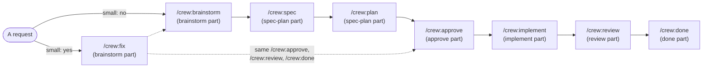

# crew

A small virtual dev team for Claude Code: four to six agents that buy context isolation, tool restriction, or independent eyes — and nothing that merely renames Claude.

Built for the awkward case: several repositories, mixed stacks, legacy code, and almost no test coverage.

---

## Contents

This README is the entry point. The reference sections moved to `docs/crew/reference/` (see [Moved sections](#moved-sections)); the sections that stayed:

1. [What this is, and what it is not](#1-what-this-is-and-what-it-is-not)
2. [Where it runs](#2-where-it-runs)
4. [Install](#4-install)
5. [Set up your first repository](#5-set-up-your-first-repository)
10. [The daily loop](#10-the-daily-loop) (autopilot and ticket statuses; the rest moved)
22. [The crew](#22-the-crew)
25. [Command and agent reference](#25-command-and-agent-reference) (commands and agents; the rest moved)
- [Moved sections](#moved-sections)
- [Diagrams](#diagrams)

---

## 1. What this is, and what it is not

**It is** a workflow: file-backed tickets, one implementation session, an independent reviewer, and deterministic gates that block on failure rather than offering an opinion.

**It is not** an org chart. A persona in a prompt adds no capability. A role earns its place only if it buys one of three things:

| Benefit | Which roles provide it |
|---|---|
| An isolated context window | `explorer`, `security`, `reviewer`, `researcher` |
| A restricted tool set | no agent holds `Write` or `Edit`; `explorer` and `researcher` hold `Bash` for one command only, the Kimi dispatch (since L-0777); `security` holds `Bash` for reads |
| Genuinely independent eyes | Codex, or `reviewer` in its own context |

Everything else — project management, business analysis, architecture, documentation, training — is a file, a command, or you. Those are not agents because there is nothing for an agent to isolate.

The single most important design constraint: **every custom subagent loads your entire `CLAUDE.md` hierarchy at startup.** A 4,000-token `CLAUDE.md` across eight delegations is 32,000 tokens of overhead before any work happens. Keep `CLAUDE.md` to a routing table of 30–40 lines. Detail belongs in commands and skills, which load only when used.

---

## 2. Where it runs

**Claude Code.** That is the target, and it is the only surface where the whole thing works.

Plugins share a file format across Anthropic's surfaces, but installation does not sync between them. Installing a plugin from the Customize menu on claude.ai does not make it available in your terminal, and `/plugin install` in Claude Code does not make it appear on the web.

That distinction matters more than usual here. In Claude chat, hooks and sub-agents from a plugin are greyed out — bundled skills work in chat, Claude Desktop's Chat tab, and Cowork, but hooks and sub-agents run only in Cowork. Since `crew` is mostly hooks, sub-agents, and slash commands operating on a local git repository, installing it on the web would give you three skills' worth of written guidance and nothing that executes.

If you want it on both surfaces, push the plugin to a GitHub repository and add that marketplace in each place separately. Two installs, one source of truth.

---

## 4. Install

**From a local directory:**

```bash
mkdir -p ~/crew-marketplace
cp -r crew ~/crew-marketplace/
claude
```

Then inside Claude Code:

```
/plugin marketplace add ~/crew-marketplace
/plugin install crew@my-marketplace
```

**From GitHub**, once you have pushed it:

```
/plugin marketplace add your-org/crew-marketplace
/plugin install crew@my-marketplace
```

Verify with `/help` — you should see `/crew:brainstorm`, `/crew:spec`, `/crew:plan`, `/crew:implement`, `/crew:review`, `/crew:done`, `/crew:status`, `/crew:help`, `/crew:migrate`, and `/crew:onboard`.

Plugin components other than skills are cached at load time. After editing agents, hooks, or `.mcp.json`, run `/reload-plugins` or restart.

---

## 5. Set up your first repository

Pick the repository you change most often. Not the most important one — the one you touch weekly. You want feedback fast.

```
cd ~/code/that-repo
claude
```

Then run the guided setup:

```
/crew:init
```

This walks nine phases, **stopping after each one** so you can check the result
before the next thing is built on it. It is resumable — `/crew:init --status`
shows where you are, and it picks up from the first incomplete phase.

| # | Phase | Produces |
|---|---|---|
| 0 | Platform | OS/WSL detection, CRLF and filesystem fixes |
| 1 | Config | `.crew/config.json`, `.crew/`, `.work/`, a filled-in `CLAUDE.md` |
| 2 | Providers | Codex and Gemini verified by a real call |
| 3 | Smoke harness | `_verify/` created and documented; `_verify/smoke.sh` green from a clean checkout |
| 4 | Code map | `.crew/codemap/` with anchors |
| 5 | Verification map | `.crew/verify.json`, each pairing proven |
| 6 | Browser tests | Playwright specs passing with no agent attached, or `n/a` |
| 8 | Promotion gates | `promote-gate.sh` and `verify-gate.sh` armed; `.work/PROMOTIONS.md` |
| 7 | First ticket | One real loop, end to end |

The rows are in run order, which is why 8 sits above 7 — First ticket runs
last, and the numbers do not match the order. Seven of the nine phases carry a
gate that stops the sequence: Phase 4 does not, and Phase 7 is last so there is
nothing after it to stop. Just one of those gates is enforced by a hook rather
than written down. See
[Setup phase order](../PLUGINS.md#setup-phase-order) in `PLUGINS.md` for the
sequence diagram, every gate, and why the order is what it is.

Phase 1 writes the repo config to `.crew/config.json`, from<!-- claim: crew-config-file:config.json -->
`templates/config.template.json`. It is the one file crew reads repo settings from: every gate and
guard, `/crew:config` and `/crew:autopilot` read it, and a new repository never needs
`/crew:migrate`. `/crew:status` shows it as `config   .crew/config.json schema 7`. `/crew:migrate` is
for a repository crew 0.20 set up, and status asks for it (`... - run /crew:migrate`) only when
this file still holds one: a role 1.0 removed, a schema older than 7, `.work/tickets/<ID>.md` ticket
files, or a PM journal.

Status is written to `.crew/STATUS.md` with honest states — `partial` and
`blocked` are used, not rounded up to `done`. A status file that overstates
progress is how the whole system quietly stops meaning anything.

You do not have to remember the command. Plain language triggers the same
phased flow — "set up crew in this repo," "set up the team," "run the phased
setup," "what phase am I on," and similar all route to it, and the behaviour is
identical either way. There is no shorter path that skips the gates.

The other skills trigger the same way: "set up gemini" or "wire up the API key"
reaches `crew-providers`, "add browser tests" reaches `crew-verification`,
"connect my vault" reaches
`crew-memory`, and "set up notifications" or "send updates to Teams" reaches
`crew-notify`.

Under the hood the phases live in one file, `skills/crew-setup/phases.md`, which
both the command and the skill read — so the two entry points cannot drift apart.

The skill will:

1. Run a detection script and report your stack, existing tests, CI, whether `codex` is on your `PATH`, and whether the repo is already configured
2. Ask exactly three questions — reviewer, ticket tracker, memory location
3. Create `.crew/`, `.work/`, `_verify/`, `docs/adr/`, and a `CLAUDE.md` if none exists
4. Tell you plainly that the setup is not yet usable

Once `/crew:verify` has built `.crew/verify.json` (Phase 5), setup offers one more,
opt-in output: `.github/workflows/crew-verify.yml`, a pull-request job that runs
`verify-gate.sh --ci` with crew fetched, outside the workspace, at the commit you installed (never a
branch). Network and host rules are named there but not run.

<!-- crew-ignore-policy:list -->
**Commit the part that is about the code, not the part that is about your box.**
The policy `/crew:init` writes is `.crew/*` ignored plus a named un-ignore list —
`!.crew/codemap/`, `!.crew/endpoints.json`, `!.crew/verify.json`,
`!.crew/standards.md`. Those four describe the repository: the code map, the
endpoint ledger a security scan is owed against, the verification map and the
development standards overlay (the `crew-standards` skill). Commit them, and `_verify/`, `docs/adr/`
and `CLAUDE.md` with them. `.crew/config.json`, `.crew/STATUS.md`, the transcripts
and the gate's own marker files stay out, and so does the whole of `.work/` —
they describe one checkout on one machine. (This line used to say `.work/`
belongs in version control. It does not; the marker files under it dirty the tree
and block the next promotion.)

**Triage your rules before writing them.** Most rules people want in CLAUDE.md
belong in `.crew/verify.json` instead — where a hook enforces them and they are
not re-paid on every delegation. The test is: *could a command decide this?*

| Rule | Goes in |
|---|---|
| Playwright on CSS changes | `verify.json` |
| tflint + terraform-docs on `.tf` | `verify.json` |
| Fresh apply + rollback + round trip on migrations | `verify.json` |
| Production needs a verified rollback | CLAUDE.md |
| Check error logs after deploy | CLAUDE.md + runbook |
| Don't fix what you notice nearby | CLAUDE.md |

Worked examples ship in `skills/crew-setup/examples/` — a Terraform
`CLAUDE.md` and the matching `verify.json`.

**Fill in the `CLAUDE.md`.** The template leaves blanks on purpose: build and test commands, where the entry point lives, which directories are off limits, and the landmine that breaks every time someone touches it. Thirty lines beats three hundred, because every line is re-read on every delegation.

---

## 10. The daily loop

### Autopilot: one ticket, driven until a person is needed

`/crew:autopilot [<id>]` (since 1.0.41, **off by default**) drives one ticket through spec, plan, approval, implement, docs, refresh artifacts, review, done and (since 1.0.349) ship, following each phase command's own procedure in the same session. It does not decide the order itself: every turn it runs `hooks/scripts/crew_autopilot.py next --root . --ticket <id>`, which names the next phase from files on disk only, so a skipped phase is visible and a phase that cannot be told stops.

**Five writers, by design (T-0010, T-0074, L-0652, T-0020).** `crew_autopilot.py` is read-only — `next`, `resume`, `settings`, `stops`, `route`, `status`, `questions-check`, T-0072's `deploy-allowed` and T-0011's `ship` (but for a sliced plan's `slices.json`, below) write no file — except `approve`, and only when `autopilot.approval` allows it under the configured policy (below; it always needs `scope.allowCliApproval: true`, which defaults to `false`, so out of the box nothing self-approves), T-0074's `auto-reject` (below), and L-0652's `sleep` and `wake`, which write or remove only `<git-common-dir>/crew/autopilot-sleep.json` (the manual sleep state, below; `sleep` also needs `scope.allowCliApproval: true`). `approve` writes exactly what `crew_ticket.approve` writes for every approval route, `/crew:approve` included, all under `<git-common-dir>/crew/`: `approval.json`; the scope ramp's `scope-tickets.json` on a ticket's first approval; and, when the review ledger is NEEDS_REPLAN and the plan is a distinct successor, the ledger itself, moved NEEDS_REPLAN -> IN_REVIEW (the successor continuation, which opens a fresh review budget). `route` and `status` read no policy of their own: `route` answers the same, and `status`'s lines — the approve and open-questions reasons included — read the same under every setting (`next` is what names the policy's route); the one policy effect `status` shows is `crew_ticket.accepted`'s, which honours an `autopilot` receipt only while the policy still allows it; `approve`, `auto-reject` and `questions-check` are script subcommands, not `/crew:autopilot` subcommands. `auto-reject` (T-0074) writes only the review ledger, through `review_ledger.reject`: REVIEWED -> NEEDS_REPLAN, with `rejected.by` the fixed name `autopilot (policy: autopilot.maxAutoReplans)`, and only when `auto_replan_policy` allows (below). Nothing in autopilot accepts a review, and a BLOCK is never accepted at any setting. `crew_ticket.py assign` and `crew_ticket.py mint` (T-0019) write a new ticket, not `crew_autopilot.py`, so the writers there stay `approve`, `auto-reject`, `sleep`, `wake` and `focus`. `ship` writes no file either; it is the one action outside the checkout — a push, a PR and, under `autopilot.ship: merge`, one merge commit (below). T-0020's `focus` approves nothing: `focus --ticket <id>` writes this worktree's entry in `<git-common-dir>/crew/autopilot-focus.json` (the explicit focus marker) and, only when the active-ticket pointer names another ticket or none, re-points it through `crew_ticket.activate` (which records `.crew/.scope-base`); `focus --off` drops only the marker entry, removing the file when no entry is left, and leaves the active ticket as it was. T-0058's `crew_autopilot.py split --check` writes `crew_split.check`'s record, and `split --apply` writes what `crew_split.apply` writes (the children, `spec.pre-split.md`, the parent's status) only while `crew_split.ticket_split_policy` allows it; bare `split` writes nothing. T-0059's `ship` on a sliced plan, `slice-done` and `next-slice` write `<git-common-dir>/crew/tickets/<id>/slices.json`, and `next-slice` creates the next slice's branch (PR slices, below). T-0012's `goal-propose` and `goal-approve` write one working file, `.work/autopilot/<slug>.json`, and never a receipt — below; since L-0541 `goal-approve` also mints the approved split through `crew_ticket.mint`, and `goal-run` records the run in the goal file.

**Subcommands** (since 1.0.47, T-0018). The command hands its whole argument string to `crew_autopilot.py route --root . --args '$ARGUMENTS'`, which decides the subcommand and the ticket in code, so a typo is refused rather than driven as a ticket id. It is single-quoted, and arguments holding a quote, `$`, a backtick or a backslash stop before anything runs, so the shell never expands them; `route --first <token>` routes one token alone. The whole string, not `$1`/`$2`: Claude Code numbers positional arguments from `$0` and leaves an out-of-range `$N` literal (measured on 2.1.283), so `$2` never reaches a command.

| `/crew:autopilot ...` | Does |
|---|---|
| `status [<id>]` | Read-only report in at most 12 lines — below. Works whether or not autopilot is armed. |
| `run [<id>]`, `<id>`, or nothing | Drives the ticket, as this section describes. `<id>` is an INDEX-shaped id (`T-0018`) or a folder under `.work/tickets/`. |
| `run <id>` for an id named like a subcommand | A ticket whose id is `status`, `run`, `assign`, `goal` or `focus` is driven as `/crew:autopilot run <id>`, and `status` suggests it that way; the bare name routes to the subcommand. |
| `assign` | Not yet from the command: stops with "arrives with T-0019". The route lands with L-0611; until then `crew_ticket.py assign` (since 1.0.302, T-0019) mints the ticket from the command line — below. |
| `goal "<goal>"` | T-0012 (below): researches the goal once, writes the goal file and proposal, prints the `/goal` line for you to paste, and asks for the split approval; once approved, L-0541 mints the tickets and starts the goal run. |
| `--goal <slug>`, `run --goal <slug>` | L-0541 (below): works the goal's tickets one at a time in dependency order, each through its own approval, inside the run's caps. |
| `focus <id>`, `focus off`, `focus` | T-0020's scope lock on one ticket: sets, releases or shows this worktree's explicit focus marker (a plain active-ticket pointer is not focus) — "Focus" under "Scope and approval". `focus off` must be exactly those two words. |
| `wave`, `wave --set <slug>`, `wave <id> <id>...` | Runs an owner-designed, approved set of tickets as parallel isolated lanes (T-0029). Since L-0727 the lanes run as the plugin's `wave` workflow (`workflows/wave.js`), started with `/crew:wave` and `{"set": "<slug>"}`: one `isolation: worktree` agent per lane, never more than `maxLanes` at once, and a lane whose agent fails or returns nothing readable is reported `unknown`, never `clean`. `hooks/scripts/crew_wave.py` stays the deterministic helper the workflow calls (`start --json` lists `launches: [{ticket, argv}]`, `lane-prompt`, `collect --json`); every lane brief now opens with a `Ticket ID: <id>` line. The 17 `crew_autopilot*.py` modules are frozen by `tests/autopilot_frozen.json`: new fan-out behaviour goes in `workflows/`. |

Any other word (`stauts`, `Status`, `rm`) stops with "unknown subcommand; one of status\|run\|assign\|goal\|focus\|sleep\|wake\|wave\|split, or a ticket id". A second word that is not a ticket id (`status stauts`), or a third word, stops too: route never reads it as a ticket.

**`/crew:autopilot goal "<goal>"`** (T-0012). The goal's text never goes on a shell line: the command routes it with `route --root . --first goal`, researches the goal once (crew:explorer, crew:researcher) and stages a proposal at `.work/autopilot/<name>.proposal.json` — `goal`, a one-line `done_condition`, `findings`, and `tickets`, each with a `title`, a `risk` and `depends_on` (indexes of earlier tickets; the recommendation first, in dependency order). `crew_autopilot.py goal-propose --root . --proposal-file <f>` refuses, writing nothing, a file outside `.work/autopilot/` (symlinks resolved) or not regular, no goal text, an empty `done_condition`, a dependency that is unknown, a cycle or out of order, or a title `mint` would refuse; otherwise it writes the goal file `.work/autopilot/<slug>.json` (schema 1; the slug is T-0006's `--goal` grammar, `-2`, `-3` on a collision) and prints `slug=<slug> goal_status=printed ...`, one line per ticket, and `goal_line: /goal <condition> - or /crew:autopilot has stopped naming a command only the owner types` (one line, at most 300 characters; the condition is cut, never the clause, so Claude Code's evaluator treats an owner stop as met). **Autopilot prints that line for you to paste; it never runs, types or reports `/goal` as set**, because Claude Code's `/goal` is only the user's to type and its state cannot be observed (`goal_status` is always `printed`). T-0013's typer is offered only when `resume.auto` is armed, `crew_autocycle.resolve_method` names a sender, and T-0013 exposes a `/goal` typing entry point — today it does not, so a `typer: not offered` line names what is missing.

The split is approved under `autopilot.approval` (`crew_autopilot.py goal-approve --root . --goal <slug>`): `self` approves it, `risk` only when every proposed ticket is a known `risk: low` (the goal's risk is its highest ticket risk; an unknown one reads `high`), `human` stops — and every setting needs `scope.allowCliApproval: true` and autopilot armed. The policy is re-asked on every call; the `approval: {via: "autopilot:<policy>", proposal_sha256}` note it leaves in the goal file grants nothing. The owner's own approval is `/crew:approve goal:<slug>`, a receipt at `<git-common-dir>/crew/goals/<slug>/approval.json` bound to the sha256 of the goal, proposal and tickets (a minted id is not part of it), valid at any setting until the proposal is edited. `goal-approve` reads that receipt; recording it is `approval_hook.py`'s, a review-harness change that lands separately — until then the hook refuses `/crew:approve goal:<slug>`. Once the split is approved, the same `goal-approve` call mints the tickets (L-0541).

**Goal runs: mint, pick, approve one at a time, caps (L-0541).** After the split approval `goal-approve` mints each proposed ticket that has no id yet, in list order, with T-0019's `crew_ticket.mint` (status `ready`; mint is unchanged and takes no risk), and prints `minted: ticket <n> <id> - <title>`. Each direction.md names the goal file, `goal-ticket: <slug> <n>/<m>`, the ticket's risk and its dependencies, and each id goes into the goal file's `tickets[].id` as it returns. A mint that fails stops (exit 2), naming the minted tickets and the `unminted:` ones, then `resume: /crew:autopilot --goal <slug>`; running `goal-approve` again mints only what is missing, and adopts a folder whose direction.md already carries its `goal-ticket:` line, so nothing is minted twice. Every goal-file write holds `.work/autopilot/<slug>.lock` (an exclusive create); a lock that is there stops, naming it — it is never broken. `/crew:autopilot --goal <slug>` (or `run --goal <slug>`) is a goal run: `crew_autopilot.py goal-run --root . --goal <slug> --session ${CLAUDE_SESSION_ID}` answers in place of `resume`. It runs only under `autopilot.mode` `plan` or `backlog`, picks the first ticket in list order that is not closed (INDEX `done`, or a spec header `done`), passes one you `cancelled` or `superseded` unless a later ticket depends on it, and stops at one that is `needs-owner`, one it cannot tell about (no INDEX row, rows that disagree), or one that is not minted. A pointer at another closed ticket of the same goal is re-pointed (`activate=1`); any other pointer stops as before. Then the caps: `plan` works one ticket per run, `backlog` goes on to the next ticket after one closes while `autopilot.maxTicketsPerRun` (default 3, tickets started in this session's run, recorded in the goal file's `runs`) and `autopilot.maxTokensPerSession` (default 2,000,000 input + output tokens, summed from this session's transcript, `<CLAUDE_CONFIG_DIR or ~/.claude>/projects/*/<session>.jsonl`, each assistant message counted once, cache tokens not counted) allow. A transcript that is not found or cannot be read stops as could-not-tell. Every stop but "the goal is done" prints `resume: /crew:autopilot --goal <slug>`. At each minted ticket's approve phase the command runs `goal-approve --root . --goal <slug> --ticket <id>`, which is T-0010's `approve` for that one ticket: its `self-approved` line goes on; a refusal stops with exactly `/crew:approve <id>` and the `resume:` line — never two ids, a range or `--confirm`. Review acceptance and production deploys still stop for you.

**`crew_ticket.py assign`** (T-0019; `/crew:autopilot assign <work>`, which researches the work into the staging file and runs this for you, lands with L-0611 — until then run it yourself, then `/crew:autopilot run <id>`). The staging file is `.work/autopilot/assign-<n>.md`: a `title:` and a `risk: low|med|high` line, then `## Ask` (the work verbatim), `## Options`, `## Recommendation` and `## Open questions` (or `none`) in `/crew:brainstorm`'s format. `crew_ticket.py assign --root . --direction-file <that file>` (a relative path is read against `--root`, and a leading BOM is dropped) refuses, minting nothing, when the file is not under `.work/autopilot/` (symlinks resolved), autopilot is not armed, the `title:` line or a section is missing, or a section is empty, the file is not a regular file (a FIFO is refused at once, never waited on), or the call carries `--title` or `--status` (refused, never ignored); a risk that is not `low|med|high` is written `high`, with a warning. Otherwise it mints exactly one ticket, `ready`, whose direction.md carries an `origin: /crew:autopilot assign` line, the title and risk, and the sections, and prints `ticket=<id> risk=<r>`. Title and risk are read from the file, never from an argument: the scope guard refuses a shell command naming `crew_ticket` with the word "approve", so a title like "approve flow" would fail there.

An assigned ticket is approved under `autopilot.approval` like any other ticket (the owner's 2026-09-26 decision): `self` approves it, `risk` only a `risk: low` spec, `human` stops, and T-0010's rules — `scope.allowCliApproval: true`, autopilot armed, a readable review ledger, `crew_ticket.validate` passing, no open question left — all apply. The `origin:` line is provenance only; nothing that grants or refuses an approval reads it. So under `self`, an assigned ticket can run from its direction to implementation with no stop before review acceptance, which, like a production deploy, always stops for you. `assign` is not `goal` (T-0012): one ticket, no goal file, no split approval.

**`crew_ticket.py mint`** is the one way code creates a ticket (`mint --root . --title <t> [--status ready|direction] [--direction-file <f>]`, or `crew_ticket.mint` in process; any other `--status` prints `refused:` and exits 1). It takes one past the highest `T-` number over `.work/tickets/` folders and `.work/INDEX.md` rows, claims it with an exclusive `mkdir`, writes direction.md complete or not at all, and only then asks `crew_tracker.py create` for the INDEX row — and, under `obsidian`, the vault note and Kanban card — then `move` to `ready`. It never writes INDEX itself. A tracker `id taken` releases the folder and takes the next id; a direction write that fails, a lock that cannot be taken, or a `create` that keeps failing, releases the folder (and, under `obsidian`, the note that `create` wrote) and refuses. A `create` whose row lands but whose card does not refuses too, keeping the ticket at `direction` and saying so. Mints hold `.work/INDEX.md.lock` across both tracker calls, `create` and the `move` to `ready`, so two concurrent mints never lose each other's row, and the id scan reads INDEX under the same lock, so it never opens INDEX while another mint replaces it (a sharing violation on Windows, L-1510). `crew_tracker.py create` and `crew_tracker.py move` run on their own do not take that lock yet (follow-up L-1511); a `create` that raises before its row is in INDEX releases the folder too, and one that raises after keeps it and says so. It refuses before claiming anything under `jira`, `sdp`, no tracker, or a tracker that could not tell, and on a title that is empty, over 120 characters, holds a `|` or a line break. A `move` to `ready` that fails leaves the ticket at `direction` with a warning: a row the move did set to `ready` (its board half failing) is put back, and the reported status is always the INDEX row's. `/crew:brainstorm` and `/crew:fix` still pick their id in prose; moving them onto `mint` is a follow-up.

**What is waiting on me** (L-0551). `/crew:status` carries one `waiting` line, and `/crew:status --owner` lists it:

```
waiting  2 on you (/crew:status --owner), 1 in review not read
T-5  approve  /crew:approve T-5
T-7  accept-review  review_ledger.py --accept --ticket T-7 --by <owner>, or reject it (...)
T-3  review-unread  /crew:autopilot status T-3
```

Both come from `crew_autopilot_owner.owner_items`, which asks autopilot's own phase table (`_phase(policy=False, deep=False)`) about every open ticket, and every ticket folder with no INDEX row, so the list cannot disagree with `/crew:autopilot`. A ticket autopilot drives, a closed one, a round a reviewer holds, and a stop `/crew:autopilot status` gives to someone else (`landing`, `blocked`) are left out; a stop that could not tell (no INDEX row, rows that disagree) names `/crew:autopilot status <id>` rather than a command; a command is never clipped. `N on you` counts the stops a person clears; `in review not read` counts tickets whose finished review round (or armed ship) would need a bundle rebuild or a gh call, which the list never runs - `/crew:autopilot status <id>` reads them; `could not tell` counts tickets whose phase read raised. `held` (L-0687) counts holds whose `revisit:` date is still ahead, and `blocked` tickets whose `depends-on:` is open; neither is listed. A hold that is due, or whose date is missing or unreadable, is listed as `revisit` with next.md's `reason:`; a `needs-owner` ticket is listed with next.md's `next:` line, else its first open question, else "cannot tell what is asked"; `landing` is the land step's and is left out. No `.work/INDEX.md`, or a module that cannot be imported, prints `waiting  unknown (<why>)`, never `nothing on you`. It writes nothing.

**`status`** (`crew_autopilot.py status --root . [--ticket <id>]`) prints: the mode; the ticket and where that choice came from (the argument, the handoff, the active ticket or `.work/INDEX.md`); the phase `next` names and its command, or why it stopped; who it waits on — `owner` with the command they type (or, when `next` stopped on the active-ticket pointer rather than on the phase, the `crew_ticket.py activate` that re-points it — or `autopilot` when no pointer is set, since `run` activates the ticket first), `autopilot`, `reviewer` for a round reserved with no result, `nobody` for a closed ticket, `owner` for `hold` and `needs-owner`, `the land step - see the phase reason` for `landing` and `another ticket - see the phase reason` for `blocked` (never `autopilot`); the review rounds left; and the handoff's `resume:` line with whether it is usable (`no .work/HANDOFF.md`, `unavailable (T-0006 not landed)`, `<line> (usable)` or `not usable: <reason>` — usable only where `resume` would take it, so a line naming no ticket or a ticket with no folder is not usable), then any `fell through:`, `disagreement:` and `warning:` lines; `--json` prints the same fields as one line of JSON. The `resume:` line is judged on the handoff status itself read, and a `.work/HANDOFF.md` that is there but cannot be read — denied, a directory, a dangling or looping symlink — prints `unknown`, never `no .work/HANDOFF.md`. What it cannot tell reads `unknown`, never a safe-looking value: an unreadable review ledger prints `review: unknown (ledger unreadable)`, not a rounds count, and a phase name it does not map prints `waiting on: unknown`. It writes nothing — no file, no git index refresh, no ledger reservation, no active-ticket change — and exits 0.

| On disk | Phase | |
|---|---|---|
| in a lane worktree, the ticket folder only in the main checkout | `folder-elsewhere` | stop — names the `cp -r` to make; a contract is never read from another checkout, because the scope guard reads Touch from this one |
| no ticket folder here, and `git worktree list` could not name the main checkout | `folder-elsewhere` | stop — says it could not tell whether the folder is in the main checkout, and why; never read as "no folder" |
| no `direction.md`, or INDEX status `direction` | `brainstorm` / `direction-approval` | stop — a human dialogue |
| INDEX rows for the ticket here and in the main checkout whose status cells differ | `direction-approval` | stop — `index-disagreement`, naming both files and both cells |
| no INDEX table row for the ticket here or, in a lane worktree, in the main checkout (or no INDEX), or a status cell that is not `ready`, `open`, `spec`, `planned`, `approved`, `in-progress`, `implement` or `review` | `direction-approval` | stop — cannot tell whether the direction was approved (Jira and ServiceDesk Plus modes write no row; a blank or unknown cell is not a yes) |
| INDEX status `cancelled`, `superseded`, `merged`, `closed`, `shipped`, `complete(d)`, or `done` without a `status: done` spec header | `closed` | stop — never re-driven; a `superseded` row names its successor (the line under the spec header, else `next.md`'s `superseded-by:`, else "successor not named") |
| INDEX status `hold`, `landing` or `needs-owner`; with none of them, the same word in the spec header as `crew_ticket_state.view` reads it (L-0550, `crew_autopilot_gates.py`) | `hold` / `landing` / `needs-owner` | stop, read-only — `hold` quotes `next.md`'s `reason:` and `revisit:` ("(passed)" once due; a date never lifts a hold, only the owner editing the status does); `landing` says the land step owns it, even with a current receipt; `needs-owner` quotes `next:` and the unanswered `## Open questions`, or says it cannot tell what is asked. A `next.md` it cannot read is said, never read as "nothing asked" |
| spec header `cancelled` or `superseded` under an INDEX cell that is not a closed word (`view`'s header read) | `closed` | stop — names the successor as above |
| `view` cannot tell the gate (two INDEX rows for the ticket disagree, or INDEX unreadable) | `direction-approval` | stop — cannot tell, quoting why |
| spec header `status: cancelled` or `superseded` | `closed` | stop — never re-driven; the reason quotes a `split-into:` / `superseded-by:` line |
| spec header `status: done` (INDEX `done` or not), autopilot unarmed | `closed` | stop — shipping is autopilot's; nothing is pushed |
| … armed: the branch's PR is merged and its merged head (`headRefOid`) is this checkout's HEAD (full SHAs), or open under `autopilot.ship: pr` | `closed` | stop — "PR #n open, merge by hand" |
| … armed: the branch's PR is merged but HEAD has moved past its merged head, or either head cannot be read | `ship` | stop — ship the later commits on a new branch and PR; autopilot never opens a second PR on a merged branch |
| … armed: detached HEAD, `gh pr view` failed or answered something that is not a PR state, the PR closed unmerged, a working tree that differs from HEAD, or the review receipt no longer stands | `ship` | stop |
| … armed: no PR yet, or one open under `autopilot.ship: merge` | `ship` | runs `crew_autopilot.py ship --ticket <id>` |
| an item under an `Open questions` heading (any level, sub-headings included) in direction.md, spec.md or plan.md | `open-questions` | stop — answered by writing `none - <answer>` or checking it `[x]`; `None of us has decided` is still open. Code fences (L-0642): main's reading is the floor; a fence at column 0, closed at column 0 by the same marker, hides nothing (its lines are neither headings nor items); any other fence shape, or a fence left open, in a file that names an Open-questions section is `could not tell` and stops, so put fences at column 0 and close each one |
| no `spec.md` / no `plan.md` | `spec` / `plan` | runs `/crew:spec` / `/crew:plan` |
| `crew_ticket.validate` refuses | `spec` / `plan` | stop, with the problems |
| the plan's `## PR slices` breaks a rule (T-0059) | `plan` | stop, `PR slices: <problems>` |
| a sliced plan's `slices.json` unreadable or out of shape, or a `status: done` header while an earlier slice is current | `slices` | stop |
| a non-final slice recorded done (`slice-done`) | the ship rows above, but a merged slice (or one open under `ship: pr`) is `next-slice` | runs `crew_autopilot.py next-slice --ticket <id>` |
| approval not accepted (none, stale, a `cli` receipt without `scope.allowCliApproval: true`, or an `autopilot` receipt the policy no longer allows) | `approve` | stop — **you** type `/crew:approve <id>`, unless `autopilot.approval` allows (`self`, or `risk` for a `risk: low` spec; both need `scope.allowCliApproval: true` and autopilot armed): then `/crew:autopilot` runs `crew_autopilot.py approve` and reports it. `status` names only `/crew:approve <id>` here, under every setting |
| approved, and a `depends-on:` ticket is not closed (`open`, `cancelled`, `superseded`, `unknown`), or the line cannot be read (L-0550) | `blocked` | stop — names each dependency with its state and why; a blocked ticket still gets its spec and plan, and one already in review stops too, as does a `ship` or `next-slice` that would act on a `status: done` ticket while a gate is set or cannot be told or a dependency is open (`ship_hold`; `ship` also reads it, with the main checkout's INDEX row, on every CI poll and right before `gh pr merge`, `hold_reason`) |
| review ledger `UNKNOWN` / `NEEDS_REPLAN` | `review` / `replan` | stop — except a NEEDS_REPLAN that autopilot's own `auto-reject` wrote for the latest round, while `autopilot.maxAutoReplans`, the cap and `autopilot.approval` still allow: then `replan` runs `/crew:plan` for a successor plan that quotes every BLOCK and FIX line, and `crew_autopilot.py approve` refuses one that does not (L-0670: `replan-check --ticket <id>` gives the same answer read-only; `/crew:approve` is never checked) |
| no review round under the current plan | `implement` | runs `/crew:implement` (its step 6 runs tests, docs, the refresh check, then review) |
| latest round reserved with no result | `review` | stop — another run would spend a round |
| latest round FINDINGS, no standing receipt, a round left, a BLOCK or FIX line, and `autopilot.reviewPolicy: fix-and-rereview` (T-0067, `crew_autopilot_fix.py`) | `fix` | runs `fix-findings <id> round <n>`: each BLOCK and FIX fixed test-first inside Touch, verify gate, commit, then each line quoted verbatim under `## Round <n>` in `.work/tickets/<id>/fixes.md` with a `fixed:` line; once fixes.md quotes every BLOCK and FIX line and the bundle changed, the refresh and `/crew:review` follow. A finding it cannot fix inside Touch, or disputes, is the `fix-refused` stop. Anything it cannot read (the policy, `rounds_left`, the row's findings or their agreement with its counts, an `ignored_lines` that is not 0, base or bundle hash, fixes.md, a bundle rebuild, an empty rebuilt bundle) is the `accept-review` stop below, naming the cause; `fix` named again right after it ran is `no-progress` |
| latest round FINDINGS, no standing owner- or auto-accepted receipt | `accept-review` | stop — names `--auto-accept` when its guard passes, else quotes its refusal; acceptance is then the owner's |
| that round has a BLOCK, no round is left, and `auto_replan_policy` allows (T-0074) | `auto-replan` | runs `crew_autopilot.py auto-reject` and reports every BLOCK and FIX line; at the cap it is the `auto-replan-cap` stop, which names `autopilot.maxAutoReplans` and every successor plan |
| no receipt stands and no review round is left | `review` | stop — `/crew:review` would reserve a third round and write NEEDS_REPLAN, which only a new approved plan leaves; revert the edit that staled the receipt, or replan |
| latest round INCOMPLETE, a refunded tool failure | `review` (`refresh` first when stale) | runs `/crew:review` |
| latest round INCOMPLETE (not refunded) | `accept-review` | stop — it cannot be accepted; a human reruns review or replans |
| artifacts `fresh-uncommitted`, receipt current or not | `commit-refresh` | runs `git add -- <the listed paths> && git commit -m "<id>: commit refreshed artifacts" -- <the same paths>` as printed, which commits only those paths (anything else already staged stays staged) — the commit changes no byte of the working state the review bundle is built from, so a receipt stays current; stop when the check names no path |
| receipt not current, the docs check `unknown` (no trusted scope base, an unreadable `docs.json`, git could not read a base blob, the check raised) | `docs-unknown` | stop at once — another `/crew:docs` run cannot settle it |
| receipt not current, a document `MISSING` | `docs` | runs `/crew:docs <id>`; stop once two recorded runs since the latest review round leave one `MISSING` |
| receipt not current, artifacts stale | `refresh` | runs the command T-0008's check names |
| receipt not current, an artifact unknown for a cause a refresh cannot settle | `refresh` | stop |
| receipt not current, artifacts fresh | `review` | runs `/crew:review` |
| receipt changed beyond an anchor sha | `stale-after-review` | stop, before the budget check — a refresh after review moved more than an anchor (L-0522) |
| receipt current, artifacts stale | `stale-after-review` | stop for the owner, no command (L-0666) — the delta gate keeps the receipt across an anchor-only refresh committed on a clean tree |
| receipt current, artifact unsettled | `stale-after-review` | stop, nothing written |
| receipt current, a document owed | `docs-after-review` | stop, nothing written — writing it now would stale the receipt |
| receipt current, artifacts fresh | `done` | runs `/crew:done` |

**Implement's status edit keeps the approval.** `/crew:implement` step 7 writes `status: review` into spec.md's header, which T-0026's approval digest normalises, so `next` moves on. An approval that edit still stales — a receipt written before T-0026, or a value outside `crew_ticket.STATUS_VALUES` — stops at `approve`; when changing only that `status:` word back makes spec.md hash to the approved bytes (and plan.md is unchanged), the reason says only the header changed, so it reads differently from a Touch widened mid-implement.

**A review phase ends at its verdict.** Whether reached as `/crew:review` or inside `/crew:implement` step 6, autopilot stops following `review.md` once the round is recorded and its BLOCK and FIX lines are reported: step 3.2's fix-and-rerun, `review_ledger.py --accept` and `gh pr review` are the human's. One extension, which neither fixes nor reruns (L-0510): after `review: auto-accept: eligible`, the phase also runs step 2d's control re-runs and, with no specialist or control BLOCK, step 3.3's `--auto-accept` and follow-up filing. The next `next` stops at FINDINGS or an unrefunded INCOMPLETE. A round `next` reaches itself gets a refresh first; the FINDINGS stop asks only for the owner's accept or reject and names `autopilot.reviewPolicy: fix-and-rereview`, under which autopilot fixes and re-reviews a round with one left itself (L-0666, replacing T-0043's naming of the refresh), and ends with one line for an owner who fixed the findings by hand: "fixed them instead? run the refresh check, then /crew:review" (owner decision 2026-10-07, `crew_autopilot_stops.FIXED_INSTEAD`, the one MECHANICAL text a stop carries). An accepted FINDINGS round whose receipt a later edit staled goes to refresh, then review, like a stale CLEAN receipt.

**The ticket is re-checked every turn.** `next` stops (`ticket-mismatch`) before any phase that would run while `crew_ticket.resolve_active` — what the scope guard and the completion audit read — names another ticket, none, or a broken pointer. Anything `next` or `resume` raises prints `stop=1` with the exception, and the command treats any answer but a `stop=0` line as a stop.

**In-flight markers: one runner drives a ticket at a time (T-0049).** Before its loop the command claims the ticket with `hooks/scripts/crew_inflight.py claim --root . --ticket <id> --runner autopilot` and releases it at every stop (`release`); a `refused:` claim is a stop. The marker is `<git-common-dir>/crew/inflight/<id>.json`, shared by every worktree of one clone (two clones share nothing; that case is out of scope): the runner (`autopilot`, `lane` or `session`), a token, the holder, the worktree and branch, `since` and `heartbeat_at`. The holder is `CLAUDE_CODE_SESSION_ID` plus the long-lived Claude Code process: `CLAUDE_PID` when it is an ancestor of the claiming command that started before it (a hint that cannot be checked, for example when no process chain can be read, is never trusted: any environment, a project's settings included, can set it), else the nearest ancestor named `claude`; a Claude Code session where neither can be found records no pid, and only when neither side has a pid does the session id decide alone; a lane's script records its own shell. Each pid comes with its start time, pid namespace, boot id and host. `claim`, `release` and `clear` write their event to `events.jsonl` first and do nothing if it cannot be written; the refusal names the file to fix or move aside before retrying. `claim` publishes the marker with `os.link`, so two claimers never both win, and starts one detached heartbeat that rewrites `heartbeat_at` every 600 s (`min(600, TTL/3)`) and exits when the marker is gone, names another token, or its holder is measured gone. `crew_inflight.holds(root, ticket)` answers `free`, `mine`, `live` (another holder in this worktree), `elsewhere` (a fresh holder in another worktree), `stale` (no heartbeat for 30 minutes, the TTL, or the holder's pid measured gone, a zombie or reused) or `unknown` (anything it cannot read, parse, probe or trust, including a reader whose own git cannot name its worktree — never `free`), and writes nothing. The pid is measured only when host, boot id and pid namespace all match the reader's: `/proc` on Linux, `kill -0` plus `ps` on macOS and other POSIX systems, the process's exit code and creation time on Windows. Where it cannot be measured (a sandbox, a session with no pid), the heartbeat stops by itself once its holder has gone 30 minutes unconfirmed, so a dead holder still goes stale within 70 minutes (2 × TTL plus one heartbeat, 4200 s): **the TTL decides whenever the pid cannot**. `next --runner autopilot` stops as `in-flight` on `live`, `stale` and `unknown`, naming the runner, ticket and since, and as `handover-elsewhere` on `elsewhere`; `free` and `mine` change nothing, and without `--runner` `next` is unchanged. **Nothing clears a marker by age, and autopilot never clears one** (`clear-inflight`): a stale or unknown stop prints the owner's command, `python3 "${CLAUDE_PLUGIN_ROOT}/hooks/scripts/crew_inflight.py" clear --root . --ticket <id> --by <you> --reason "<why>"`. It re-reads the state under the lock, accepts only `stale` or `unknown` (an unreadable marker is cleared by the owner, never by age), and logs who and why. `holds --root . --ticket <id> [--json]` prints the answer on one line. A workflow lane adopts the same CLI with `--runner lane`.

**Refresh sits between implement and review, every round.** A review bundle excludes only `.work/`, generated `graphify-out/`, crew's own bookkeeping (`crew_ticket.CREW_BOOKKEEPING_PATHS`, since T-0068) and paths byte-identical to merged main, so a codemap, diagram or `.claude/rules/` refresh written after an accepted review changes the bundle (a graph rebuild alone no longer does, since 1.0.54). The delta gate (L-0522, only where this clone's merge train is armed) keeps the receipt when the refresh moved nothing but an anchor sha; anything more reads stale and `/crew:done` refuses. Check E runs first, on `.work/`, `graphify-out/` and `.crew/metrics.md` over three ranges: receipt base -> reviewed head, reviewed head -> HEAD and reviewed head -> the index. Only the two graph files may change (text, mode 100644). Since L-0739 the first range also passes a committed text change the bundle carries, but only when the receipt's bundle really carried it: a receipt minted before L-0739 reads `excluded path changed: <path> (receipt base -> reviewed head): this receipt's bundle did not carry it, so it is outside the bundle; re-review so it is included`. A binary, executable, symlink or gitlink change, an ignored force-added file or a `graphify-out/` file there reads `outside the bundle, which cannot show it (<why>); restore it in a new commit, then re-review`. After the reviewed head nothing changed: any `.work/` change committed or staged after the review is stale, as before. A review run writes `.work/tickets/<id>/review.json` and appends `.crew/metrics.md` in the checkout it runs in; in a repository that tracks those, run the review from another checkout of the same commit so the deploy tree stays clean for promote-gate (the ledger is shared through `<git-common-dir>/crew/review/`; L-0745 tracks the fix). Autopilot never refreshes after review on its own: it stops with the refresh command (run it, commit, rerun). A merge of main that touches no reviewed path does not stale a receipt (T-0100): the rebuilt bundle leaves out paths identical to the merged commit and `--check-receipt` says how many (and `fork: could not tell` when the merge-base of the start and the merged commit had no answer); a merge that changes a reviewed path still does, conflict or not, because that file's diff now starts from main's version. The freshness judgement is T-0008's `crew_refresh_check.ticket_freshness`. A `stale` artifact is refreshed with the command it names. An `unknown` one is refreshed only in T-0008's orphaned-anchor case — the anchor names no commit (a squash merge dropped it), T-0008 marks it refreshable and names the command; every other `unknown` (graphify missing, no or a fallback scope base, a check that raised) stops, as `/crew:implement` step 6 does. When the module cannot be imported the phase stops as "refresh-artifacts unavailable (T-0008 not landed)" rather than being skipped. A `fresh-uncommitted` answer (crew 1.0.349) is the `commit-refresh` phase, before review and after an accepted one alike: committing exactly the paths the check lists leaves the review bundle — the working state — unchanged, so it is never a reason to review again or to close over unsaved artifacts.

**Which ticket** (`crew_autopilot.py resume [--ticket <id>]`): the id you gave; else the handoff's `resume:` line, parsed by T-0006's `crew_resume.parse_resume` and used only when the handoff's `branch:` and `head:` match this checkout and the ticket folder exists; then (L-0659) the one autopilot goal whose run state is `running` in `.work/autopilot/`, resumed at its next ticket with source `goal-file` — two running goals stop and list them (`name one: /crew:autopilot --goal <slug>`), a goal file that cannot be read stops as could-not-tell and the active ticket is not driven, and a `stopped` goal is named in a `fell through:` line with its reason and its `--goal` command, never resumed; then this worktree's active ticket; then `.work/INDEX.md`, **only when exactly one** open ticket has a folder — several open tickets and no pointer stop and list them. In a lane worktree (crew 1.0.349, T-0063) the main checkout's INDEX — the first record of `git worktree list --porcelain` — supplies the rows this checkout's lacks, and the source then reads `.work/INDEX.md (main checkout)`; the folder must still be here. `next` reads a ticket's INDEX row the same way, and `--json` names the file that answered as `index_source`; rows in both that disagree stop as `index-disagreement`, and a listing git cannot give is kept in the stop's reason, never read as "no row". A handoff that cannot be used (no line, `resume: none`, unparseable, branch or head mismatch, no folder, T-0006 not installed) falls through with its reason printed; `## Next action` prose is never guessed from. When the handoff names a different command from the one disk names, disk wins and the disagreement is printed. `resume: /crew:autopilot --goal <slug>` (L-0541) resumes that goal at its next ticket, or stops with the goal's reason. **The branch and head checks are the ticket form's (L-0658):** a goal moves across ticket branches, so a `--goal` line is judged by its goal file instead — taken only while its `run.state` is `running`; a missing, not-started or done goal falls through with its reason; a goal file that cannot be read stops as could-not-tell, and a `stopped` goal stops, named with its recorded reason and `/crew:autopilot --goal <slug>`, never resumed past it. **A ticket that is not this worktree's active one stops**, naming both — the scope guard and the completion audit judge edits by the active pointer; with no pointer set, autopilot activates the ticket it drives (`crew_ticket.py activate`). When context runs low, autopilot writes `resume: /crew:autopilot <id>` (in a goal run `resume: /crew:autopilot --goal <slug>`) into the handoff and stops.

**Lint rules for known finding classes (L-0715).** `lint/semgrep/crew-classes.yml` holds pinned semgrep rules for five recurring review-finding classes: `splitlines()` on file, stdin or child-process text (U+2028), `json.load`/`json.loads` without `object_pairs_hook`, a bare `pwsh`/`python3` in a `subprocess` list, an unquoted `CLAUDE_PLUGIN_ROOT` in a command file, and a `test_*` with no assertion. Symlink and FIFO opens are listed `not-shipped` (not expressible by a pattern). Opt-in and inert for now: a repo lists the linter in its own `.crew/verify.json` once the `semgrep` linter kind lands in a second change, and nothing runs by default. `tests/test_crew_lint_rules.py` runs the pinned semgrep over the fixtures and fails if it cannot start; `CREW_SKIP_SEMGREP=1` skips it, and the two semgrep-running tests skip on native Windows (semgrep ships no `semgrep-core.exe` there; the stdlib checker for every host is PR B).

**Documents before review, the tracker after every phase (T-0022, ported in the 1.2.0 feature rush).** The phase order is implement, docs, refresh, review, done. `/crew:docs <id>` records why each document it leaves alone is `not needed`, and each deferral, in `.work/tickets/<id>/docs.json`; the read-only `crew_docs_check.py --root . --ticket <id>` then prints every document `updated`, `not needed (<reason>)` or `MISSING`, plus `adr, runbooks: not measured`. The CHANGELOG rule is mechanical and never waived: a marketplace entry whose source changed needs a line the ticket itself added, under `## [Unreleased]` or `## [<version>]`, naming `` `<name>` `` (or the bare name right before the version) at the version its own range ends on — so a close after a later release still finds it (L-0753; release bookkeeping and `.work/` alone owe none). The changed set is check 4's own one, so a workflow another PR brought in through a main merge does not make SECURITY.md owed. README (an entry's `commands/`, `agents/`, `skills/*/SKILL.md`, `hooks/hooks.json` or `CONFIG.md` changed, or the marketplace's entry names did) and SECURITY.md (a guard, `approval_hook.py`, `promote-gate.*`, a `hooks.json`, an install script, a workflow) need an edit or a recorded reason once triggered; every deferral must reach TODO.md. No trusted scope base, an unreadable docs.json, or git unable to read a document at the base is `unknown` (never `updated`), which refuses like MISSING. `/crew:implement` step 6 and `/crew:done` check 5 run the same check; check 5 never edits. Autopilot runs the docs phase before the refresh, at most twice per review round for a `MISSING` document and not at all for `unknown`, which stops at once (`docs-unknown`) (`crew_autopilot.py tracker --after "/crew:docs <id>"` records each run), and a document owed after an accepted receipt stops as `docs-after-review`. After each phase and after `/crew:done`, `crew_autopilot.py tracker --root . --ticket <id>` derives the status from disk (`in-progress` once a path outside `.work/` changed since the recorded scope base, which `activate` records before implement) and calls T-0021's `crew_tracker.move`: unchanged when the tracker agrees, the sync command handed back for Jira or SDP, a stop with the reason and the `crew_tracker.py move` retry when it could not update. It may follow an accepted review because no tracker write enters the bundle — `.work/INDEX.md` is excluded, a vault outside the worktree or one git ignores is not staged, and T-0021 refuses an in-worktree vault git does not ignore; `test_tracker_move_after_receipt_keeps_bundle_hash` measures it against `review_patch`'s own hash.

**Stops.** Always a person: `brainstorm` and `review-acceptance` — accepting review FINDINGS with any BLOCK, or a round `review_ledger.py --auto-accept` refuses, is the owner's (`review_ledger.py --accept`), at any setting; only a final 0-BLOCK round is accepted by the ledger's guarded verb. With `autopilot.maxAutoReplans` an out-of-rounds BLOCK round is rejected and replanned instead, never accepted. `plan-approval` and `open-questions` are a person unless the owner's policy below allows. Enforced by `next` from disk: the ticket's gate `hold`, `landing` and `needs-owner`, and `blocked` (L-0550), `needs-replan`, `needs-replan-or-revert`, `unknown-ledger`, `failed-validate`, `direction-unknown`, `index-disagreement`, `unsettled-artifact`, `ticket-mismatch`, `max-phases`, `auto-replan-cap` (`autopilot.maxAutoReplans` successor plans already on the ledger), `drift` (explicitly focused and approved, a changed path outside Touch — "Focus" under "Scope and approval"), `no-progress` (the command just run is named again; not `/crew:review` after a refunded tool-failure round, which is a new round each time it records one, nor `/crew:docs` after a recorded attempt), `docs-missing`, `docs-unknown`, `docs-after-review`; enforced by the tracker step: `tracker-failed`, `tracker-unavailable`, and, with `--runner`, `in-flight` and `handover-elsewhere` (in-flight markers, below). Enforced by the command's procedure, not by `next` — which sees them only as `no-progress` if the same command comes round again: `review-verdict`, `failed-done-check`, `failed-phase`, `fix-refused` (T-0067). And every `AUTONOMOUS_STOPS` entry — `offboard-role`, `delete-map`, `rewrite-metrics`, `git-destruction`, `clear-inflight` — which `commands/autopilot.md` names and a test pins against `crew_state.AUTONOMOUS_STOPS`. `crew_autopilot.py stops` lists them all from code. **Every stop names an owner decision** (L-0666, `crew_autopilot_stops.py`): `next` prints `decision=<id>` (and `--json` a `decision` field) on a stop, one of `OWNER_DECISIONS` (`stops --json`'s `decisions` group: `direction`, `answer-question`, `fix-contract`, `approve-plan`, `approve-split`, `replan`, `accept-review`, `spend-round-or-replan`, `revert-or-replan`, `look`, `stale-after-review`, `activate-ticket`, `continue`, `clear-inflight` (a stale or unknown in-flight marker, whose stop carries the owner's `clear`), `closed`); its `command` is empty or that decision's own, and its reason never hands the owner a refresh, a graph build, a review round within budget or a crew helper (`MECHANICAL`). So the FINDINGS stop asks for the accept or reject, names `autopilot.reviewPolicy`, and carries only `FIXED_INSTEAD` besides; the ticket-mismatch stop names only `crew_ticket.py activate`; an unsettled-artifact stop lists only what a refresh cannot settle; and the `docs` and size-check stops carry no command. `test_crew_autopilot_stop_contract.py` walks every stop site and fails on one without a case. No deploy or new ticket: T-0005, T-0012 (the one push, PR and merge are `ship`'s, below); the new tickets are step 3.3's follow-up after `--auto-accept` and the children of a split autopilot applies under the policy (below). Since T-0058 `next` also enforces `split-approval` and `split-check-unknown`.

**The size check after spec and after plan (T-0058).** Once the spec validates, and again once the plan validates, `next` runs the split rulebook's measures (`crew_split.measure` and `triggers`, below: acceptance checks, codemap subsystems, the findings rate, and plan steps after plan). **A trigger means look, never split.** Nothing fired continues. A fired trigger with no current `split.md` decision is `split-check` — not a stop: autopilot runs `crew_autopilot.py split --root . --ticket <id>`, judges the boundaries by the rulebook (crew:explorer), writes `split.md` with `answered:` naming every fired trigger, and runs `split --check`; a decision is current only while it passes the rulebook and names every trigger now fired, so a trigger that first fires after plan re-opens a decision taken after spec. `not-too-big` continues. `slices` continues after spec; after plan only when the plan's `## PR slices` validate through T-0059's `crew_split.parse_slices`, and until that lands it stops as `split-check-unknown` naming T-0059 — never continuing as though the slices were checked. `split` is `split-approval`, a stop: `crew_autopilot.py split --apply` runs `crew_split.apply --via autopilot`, which is allowed only by `crew_split.ticket_split_policy` — T-0012's split rule on the parent's spec risk (`self` any risk, `risk` only a known `risk: low`, `human` never; always `scope.allowCliApproval: true` and `autopilot.mode: plan`), asked at apply time and never read from a record. **In Jira mode a split always stops for the owner**, whatever `autopilot.approval` says: autopilot never creates a Jira issue, and the owner runs `/crew:split <KEY>`. SDP stops: SDP is a service desk, not where this work gets decomposed. Any caller may pass `--via autopilot` — as with `crew_ticket.approve`, whoever calls, the gate is the repository's policy, not the caller, and out of the box it refuses (`scope.allowCliApproval` false, autopilot off). `split --check` and `split --apply` apply the gate's rules at the gate's stage (`plan` only once plan.md validates): both refuse while a measure is unknown, with the gate's `split-check-unknown` wording, and both hold `split.md`'s `answered:` to every trigger firing now. A refusal prints `owner: the human types /crew:split <id>` last; autopilot never runs `/crew:split` itself. Once applied the parent is `superseded` and reads `closed`. A measure whose source is there and cannot be read or counted stops as `split-check-unknown`, naming the fix: a `.crew/codemap/` with no readable subsystem, an unreadable `.crew/metrics.md`, and T-0052's zero counts — an Acceptance section of plain `- ` bullets with no `- [ ]`, a plan whose steps are `## Step` rather than `### Step`, a Touch entry no codemap subsystem covers; a source the repository does not have at all — no codemap, no review recorded yet — is printed as `unmeasured: <name> (<why>)` and does not stop (`crew_split.absent_sources`). `/crew:autopilot split <id>` runs the same check on demand. At a `split-approval` stop the report's `crew_notify.py run-stop` sends T-0060's blocker `Approval waiting -> /crew:split <id>` (once per `split.md`).

**Settings** (`.crew/config.json`, and since T-0050 the machine-global file too for `mode`, `maxPhases`, `deploy`, `approval` and `questions`: the stricter of the two layers wins, a silent layer imposes nothing — `docs/crew/config-rationale.md`, "Personal keys and the per-key ratchet"; `maxAutoReplans`, `sleep`, `ship` and L-0541's two caps stay repo only): `autopilot.mode` — `off` (default), `plan`, or `backlog` (L-0541: a goal run goes on to the goal's next ticket; `backlog` ranks above `plan`, so where both layers set the key the stricter wins); only the exact strings `plan` and `backlog` arm it, and any other value reads as `off` with a warning. `autopilot.maxTicketsPerRun` (default 3) and `autopilot.maxTokensPerSession` (default 2000000 input + output tokens, each assistant message counted once) are a goal run's caps (repo only, L-0541); anything but a positive integer reads as the default with a warning. `autopilot.maxPhases` — phases one invocation may run, default 12; anything but a positive integer reads as 12 with a warning. `autopilot.deploy` — `none` (default), `nonprod` or `all`: where a deploy may run without asking. Production needs `all` **and** `environments.prodUnattended: true` in **both** config layers, with `guards.cloudGuard` armed in `block`; anything crew cannot tell asks, and an active emergency refuses. `crew_autopilot.py deploy-allowed --env <name> --class <class>` answers `allow`, `ask` or `refuse` and prints a report line for every production decision. The deploy phase (L-0649) consumes it: after the PR merges, `next` names `/crew:promote <env>` for the first `github` environment with no PROMOTIONS row for the sha (nonProd first) when `deploy-allowed` answers exactly `allow`, and stops with `deploy-target` (cannot tell, or not safe to drive) or `failed-deploy` (the newest row is not all-pass); autopilot itself dispatches nothing (`docs/crew/config-rationale.md`, "autopilot"). `autopilot.maxAutoReplans` (T-0074) — `0` (default, off) or an integer from 1 to 5: how many successor plans one ticket may have before an out-of-rounds BLOCK round stops for you again. At 1 or more, armed, and only where `autopilot.approval` would approve the successor plan, autopilot rejects a final FINDINGS round with a BLOCK itself (`crew_autopilot.py auto-reject`), runs `/crew:plan` for a successor plan, approves it under the policy and reviews again; an INCOMPLETE round, a same-family or unknown reviewer, a round still left, or anything it cannot tell is today's stop. The cap counts every successor plan on the ledger, yours included; the recommended value when you turn it on is 2. Anything but a non-negative integer reads as 0 with a warning, and anything above 5 reads as 5. `autopilot.ship` (T-0011) — `merge` (default) or `pr`; anything else reads as `pr` with a warning. L-0725: no failing check is excused and the CI wait is fixed at 60 minutes (`autopilot.knownFailures` and `autopilot.ciTimeoutMinutes` are gone). `ship` (below) reads `autopilot.ship`, shown by `settings --json`. An `autopilot` block only in `.crew/crew.json` is reported, not silently ignored; `/crew:migrate` carries the block to crew.json's top-level `autopilot` with a note that this copy is never read: crew reads `.crew/config.json`, and the personal keys also the machine-global file, where the stricter value wins (`docs/crew/config-rationale.md`, "Personal keys and the per-key ratchet"). `crew_autopilot.py settings --root .` shows what is in force: `mode`, `maxPhases`, `deploy` and `maxAutoReplans` on its first line, `approval` and `questions` on the second, the sleep window's `sleep=` line on the third, the goal caps on the fourth, and all of it with `--json`. A key this crew does not act on yet (a typo, say) adds a `warning: inert:` line naming the ticket that brings it; it never stops a run. The same keys are named in one `Inert settings` line at every session start and an `inert` line in `/crew:status` (T-0070, `docs/crew/config-rationale.md`, "Inert settings").

**Approval and questions policies** (T-0010). `autopilot.approval` and `autopilot.questions` are `human`, `self` or `risk` (default `risk`); any other value reads as `human`, with a warning, and `human` always stops. At the plan-approval phase autopilot runs `crew_autopilot.py approve --root . --ticket <id>`: `self` approves at any risk, `risk` only when the spec's header says `risk: low` (a missing or unparseable risk is `high`). **Every `autopilot.approval` setting also needs `scope.allowCliApproval: true`** (`autopilot.questions` does not), a readable config (a `.crew/config.json` that exists but cannot be read as a JSON object, or an `autopilot` value that is not an object, reads both policies as `unknown` — could not tell — so `approve` refuses, a question stops and autopilot reads as off; an absent file or block still reads the defaults), autopilot armed, and a readable review ledger. A NEEDS_REPLAN ledger does not refuse: approving a different successor plan is its only way out, and the ledger still refuses a plan approved before (`crew_autopilot.py approve` exits 3 and says so). The receipt says `approved_via: "autopilot"`, the command prints `self-approved <id> under approval=<policy>, risk=<risk>`, and `crew_ticket.accepted` re-asks the policy on every read — a later spec edit, `approval: human` or `allowCliApproval: false` demotes it. The scope guard allows only that bare command, only while the policy says yes; `crew_ticket.py approve` stays refused. Autopilot never uses the group confirm ("Approving several tickets at once"): that stays the owner's own prompt, and `crew_ticket.approve` refuses an `autopilot` approval that carries a group's hashes, whatever the policy says. At an open question autopilot researches it (crew:explorer, crew:researcher), writes `.work/tickets/<id>/questions.md` — 2-4 options per question, the recommendation first, each with a `Cost:`, plus a `Research:` line — and `crew_autopilot.py questions-check --root . --ticket <id>` validates it and prints `action=take|stop`: `self` takes the recommendation, `risk` only on `risk: low`, `human` stops. A taken answer is recorded as `taken: Option <id> by autopilot (<policy>)`, naming the policy that took it; the check refuses one naming a policy that never takes (only `self` or `risk` does), and every `taken:` line while the policy in force says `stop` — a later switch between `self` and `risk` does not void an earlier honest record. Every self-approval and taken answer is reported by name.

**Sleep schedule** (T-0053). `autopilot.sleep.schedule` (`HH:MM-HH:MM`, machine local time, may cross midnight; default `null`, off) names one nightly window. Inside it, `autopilot.sleep.approval` and `autopilot.sleep.questions` (`human`, `self`, `risk`, or `null` for "keep the day value") replace the two day values, so an overnight run can approve its own plan or take a recommendation where the day setting would stop. `autopilot.sleep.deploy` (L-0654: `null`, `nonprod` or `none`; `all` is refused) does the same for `autopilot.deploy`, and asleep an effective `all` reads as `nonprod` — production never runs unattended asleep; `deploy-allowed`'s reason names the sleep state when it changed the answer. Every approval and answer made while asleep is appended to the local, ignored `.work/autopilot/sleep-log.md` with the setting that allowed it (L-0653); `wake`, and `crew_autopilot.py sleep-summary` once `settings` warns that decisions are unreported, print them once, grouped by ticket. L-0725: no ping is held while asleep any more (`autopilot.sleep.notifyHold` is gone); every ping sends as it is raised. The morning summary is still sent once through `notify`, and it still reports and clears a held-ping record an earlier version left. The window is re-read from the clock at every decision, so a run that crosses the end of the window is back on the day values at its next one. A schedule, `sleep` block, clock or resolver crew cannot read is `unknown`, with a warning: per key the stricter of the day value and a valid night override applies (`human` over `risk` over `self`), never a looser one; an override that is not a policy (`"Human"` included) or cannot be read at all counts as `human`, and a non-object `autopilot.sleep` reads `human` for both keys. The clock is local time in the process's `TZ`, and `approve` / `questions-check` run in the model's shell environment. A window may be up to 23h59, and a looser night value applies for all of it; `scope.allowCliApproval: true` and every stop still bind asleep. `crew_autopilot.py settings` prints `sleep=<off|awake|asleep|unknown> schedule=... approval=... questions=...`, and a policy a night override set ends its reason with `(asleep <window>; day value <day>)`. **A receipt written asleep stops standing when the window ends** if the day value would not have approved it: `crew_ticket.accepted` re-asks the policy, so in the morning that ticket waits for `/crew:approve <id>` (the overnight work stays). **Manual sleep** (L-0652): `/crew:autopilot sleep` starts sleep mode now, until the window's end (12 hours with no window), and `/crew:autopilot wake` ends it now; the state lives in `<git-common-dir>/crew/autopilot-sleep.json` (UTC times, a regular file only), shared by every worktree, and `settings` adds `source=manual until=<HH:MM>`. **Until L-1504 a manual sleep only tightens** (owner decision 2026-10-04): outside the window it applies a night value only where it is stricter than the day value, because the session can run the CLI itself; L-1504 makes the approval hook accept only the owner's typed `/crew:autopilot sleep` and then unlocks loosening. `sleep` refuses unless `scope.allowCliApproval` is exactly `true`, autopilot is armed and some override is stricter than its day value (or the window is open); a state file crew cannot trust reads `unknown` (the stricter value per key), and `wake` never loosens a night value stricter than the day. `docs/crew/config-rationale.md` ("autopilot") has the details.

**Ship** (T-0011, `crew_autopilot.py ship --root . --ticket <id>`, after `/crew:done`). It refuses unless `next` names `ship`, refuses the default branch (or one it cannot read) and a working tree that differs from HEAD (`git status --porcelain --untracked-files=all`, ignored files aside; a receipt can cover uncommitted edits a push does not carry) before pushing, runs `git push -u origin <branch>` (never force), `gh pr create --head <branch> --fill` when there is no PR, and under `autopilot.ship: merge` polls `gh pr checks <n> --required` every 30 s up to 60 minutes (fixed, L-0725). It merges with exactly `gh pr merge <n> --merge --match-head-commit <HEAD>` — bound to the commit whose checks and receipt it read, so a push that lands afterwards is refused rather than merged; a merge commit, never `--squash` or `--rebase`, because either rewrites the ticket's commits and orphans every codemap and diagram `anchor:` that names one (D-028); never `--admin`, never a bypass of branch protection — only when every required check is `pass` (names and states are read verbatim, never trimmed or re-cased; no failing check is excused, L-0725), the PR's head and this checkout's HEAD are still the commit it took right after the push (checked before and after every poll and again right before the merge), the tree is still clean, the review receipt still stands after the wait on the same ledger bytes the review families came from, and the base branch has no merge queue (a queue picks its own merge method and keeps merging after `ship` stops; one it cannot read stops too); it then confirms the PR reads MERGED. If gh queued the PR anyway (a queue enabled after the check), `ship` dequeues it once with GraphQL's `dequeuePullRequest` — the only mutation it ever sends — and stops, naming the queue and whether the dequeue worked. The settings, the risk and the review families are re-read on every poll, so disarming autopilot, switching to `ship: pr` or a ledger that turns same-family while CI runs all stop it, and a green that lands after the timeout stops like a pending one. Pending, or no required check reported yet, waits; skipped, unknown, unreadable or a failed check stops. **A `high`-risk ticket (or one whose header names no risk) never merges on same-family reviews** — every completed round `claude`, or with no `model_family` recorded, which counts as the author's family. Codex, the only cross-family reviewer here, was out until 2026-10-01, and while it is unavailable every review is same-family, so every `high`-risk ticket stops at `ship: merge` with its PR open for you to merge. It prints `action=… stop=… pr=… reason=…`, then the `checks:` and review `families:` it rested on. gh 2.46's `gh pr checks` has no `--json`, so its text output is parsed; a line or exit code that does not fit - a row that is not exactly five tab-separated fields (gh prints a check's name and description unescaped, so a tab inside one is unreadable and that check never ships unattended), exit 1 with no failing row, or anything on stderr beside the rows - reads as unreadable, never green.

### Ticket statuses

One vocabulary, owned by `crew_tracker.py` (`STATUS_ORDER`, `OWNER_STATUSES`, `CLOSED_STATUSES`, `LANE_FOR_STATUS`); every other reader's list is held to it by `tests/test_status_vocabulary.py` (T-0037).

| Word | Open or closed | Written in | A spec header edit to it | Obsidian lane | Jira / SDP |
|---|---|---|---|---|---|
| `direction`, `ready` | open | INDEX, tracker | stales the approval (not in `STATUS_VALUES`) | `backlog` | nothing pushed |
| `spec`, `planned`, `review` | open | INDEX, tracker, spec header | keeps the approval | `ready` (`spec`, `planned`), `review` | nothing pushed |
| `in-progress` | open | INDEX, tracker, spec header | keeps the approval (T-0059's non-final slice) | `inProgress` | pushed |
| `needs-owner` | open, waiting on the owner | INDEX, tracker only — never a spec header | stales it, like any unknown word | `backlog` | nothing pushed |
| `done` | closed | INDEX, tracker, spec header | keeps the approval | `done`, checked | pushed |
| `cancelled`, `superseded` | closed | INDEX, tracker, spec header | stales the approval on purpose | `done`, checked | nothing pushed; the owner closes the item by hand |

Any other INDEX word maps to no lane: `move` refuses it with nothing written, and `crew_tracker.py read` reports it as `could not tell` (`INDEX status <s> is not a status crew knows (...)`), never as a disagreement. The words the owner retired on 2026-10-05 get a text-only hint naming their replacement (`RETIRED_STATUSES`: `approved` -> `spec`, `merged` -> `done`, `closed` -> `done`, `new` -> `direction`, `parked` -> `needs-owner`) — never a lane, a write or an exit code (L-0530).

`approved` and `merged` are spec-header words only (they keep the approval; a header `merged` does not close a ticket for autopilot). `crew_ticket.STATUS_VALUES` is unchanged by T-0037: it is the approval-keeping subset, so a blocking hook accepts nothing new.

- **Closed** means closed in every reader: the session brief and `crew_ticket.resolve_active`'s INDEX fallback skip the row (a prose `- Cancelled: T-1` line too, in any case), `/crew:approve`'s precheck refuses it as "closed in .work/INDEX.md", autopilot stops it as `closed` (waiting on nobody), and `/crew:status` lists it on no line.
- **Cancel** a ticket with `crew_tracker.py move --ticket <id> --to cancelled`; the INDEX row alone closes it. A ticket replaced by others is `superseded`, with `split-into: <id>, <id>` (T-0052) or `superseded-by: <id>` on its own line under the spec header. Moving out of `done`, `cancelled` or `superseded` — to any word — needs `--reopen`, and without it the move is refused with nothing written.
- **`needs-owner`** moves to and from any open word without `--reopen`. The question for the owner goes under the ticket's existing `## Open questions`. `/crew:status` prints `owner    <ids> (needs-owner)`. A non-ticket item that needs the owner is minted `ready` (`crew_ticket.py mint`), then moved to `needs-owner`.
- **Derived, never typed: `blocked` and `needs-replan`** (L-0639). `hooks/scripts/crew_ticket_state.py` answers them for one ticket, read-only, and autopilot's `hold`, `landing`, `needs-owner`, `closed` and `blocked` stops act on it (L-0550; L-0551's owner list will too). `blocked` comes from the optional `depends-on: [T-1, T-2]` line under the spec header (hashed with the spec, so changing it needs `/crew:approve` again): each dependency is `closed`, `open`, `cancelled`, `superseded` or `unknown`, read from its INDEX status cell first and, with no row, its spec header (`done` or `merged` is closed). Every state but `closed` blocks - a cancelled or superseded dependency will never close as done, so it blocks and is named. `needs-replan` comes from the review ledger's `NEEDS_REPLAN`. A typed `blocked` or `needs-replan` INDEX cell is reported as a problem, never obeyed. The could-not-tell rule holds throughout: an unreadable INDEX, a row with no status cell or no row and no spec makes a dependency `unknown` (it blocks); no spec or an unreadable `depends-on:` line makes `blocked` None, an unreadable INDEX makes the gate `unknown`, and an unreadable ledger makes `needs_replan` None with a problem - never False. **`done` counts as closed** for a dependency, before it is merged (approved 2026-09-26; accepted as risk). The gating statuses `hold`, `landing`, `needs-owner`, `cancelled` and `superseded` are read from the INDEX cell first, then the spec header; `hold` stays an open word everywhere else.
- **`next.md`: who a ticket waits on and what happens next** (L-0640). A ticket folder may hold `.work/tickets/<id>/next.md` with up to five `key: value` lines (key case-insensitive, blank and `#` lines skipped, unknown keys ignored): `waiting-on:` (`owner`, `agent`, `external` or a ticket id), `next:` and `reason:` (one line of free text, shown clipped to 200 characters), `revisit:` (`YYYY-MM-DD` only) and `superseded-by:` (a ticket id). `crew_ticket_state.read_next` parses it and `view` carries the fields as `next`, plus `revisit_due` (True on or after the date, False before it, None with no date or a bad one). It is local state and not part of the contract: it is not hashed, `/crew:approve` does not validate it, and nothing in crew writes it automatically - you edit it by hand. A bad, empty or repeated value is a problem and that field is unset; a `next.md` that cannot be read, or that resolves outside the ticket folder, is a problem and every field is unset (cannot tell, never "nothing asked"). A `needs-owner` gate with no `next:` reports `needs-owner: cannot tell what is asked (no next: in next.md)`, and a `superseded` gate reports that it cannot tell what replaced it when neither `next.md`'s `superseded-by:` nor a `split-into:` / `superseded-by:` line under the spec header names the successor ticket ids (`TBD` names none).

## 22. The crew

crew 1.0 ships four agents: `explorer` (read-only mapping), `reviewer` (the
Claude rung of `qa.order`, renamed from `qa-reviewer`), `security` (read-only
review of risky changes) and `researcher` (external sources only). The
interactive session implements; nothing else is dispatched to write. Stack
knowledge that used to be specialist agents loads on demand as the `stack-*`
skills. There is no PM agent, no Stop pulse and no journal, and nothing grows
or shrinks the roster: `/crew:status` reports it read-only. The Haiku 5.5
`session-relay` that carries messages between sessions is a transport agent,
not a fifth role (see Agents).

The coordinator is a model pin on an existing role (L-0799), not a fifth role:
`dev.roles.coordinator` (default unset) is printed by `crew_wave.py start` as
`coordinator: model <id>`, a report of the pin (wave launches no coordinator);
`docs/crew/config-rationale.md` has the details.

Parallelism scales on independent work units, not job titles.

| Arrangement | Actually parallel? |
|---|---|
| Two repositories | Yes — the good case at your repo count |
| Two git worktrees of one repo | Yes, with merge cost at the end |
| Two agents, one working tree | No. Conflicting edits and lost writes |

---

## 25. Command and agent reference

**Hook registrations (crew 1.2.58, L-0850).** `hooks/hooks.json` registers 16 entries, one launcher per event per shell for eight events (`crew-hook.sh`, and `crew-hook.ps1` with `shell: powershell`), where it used to register 36. The launcher starts `hooks/scripts/crew_hook.py <Event>`, which runs that event's hook scripts and merges their results (exit 2 wins; deny over ask over allow). On Windows only the PowerShell launcher acts, so no event runs twice. In a repository crew governs, a dispatcher fault, a missing hook script, a guard past its timeout or a launcher crash refuses the call (exit 2, naming the cause) on `PreToolUse`, `UserPromptSubmit` and `Stop`; in a repository it does not govern it exits 0. A hook override that names a script path no longer matches. The per-script table is in [Hooks](../../docs/crew/reference/25-command-and-agent-reference.md#hooks) and the decision is [ADR 0009](../../docs/adr/0009-hook-single-dispatch.md).

**Ten hook twins deleted, `sendkeys` removed (crew 1.2.61, L-0867, slice 3 of L-0727).** The PowerShell twins `cloud-guard.ps1`, `env-guard.ps1`, `role-write-guard.ps1`, `crew-context.ps1`, `handoff-read.ps1`, `handoff-write.ps1`, `notify.ps1`, `platform-sync.ps1`, `context-watch.ps1` and `auto-clear.ps1` are gone. On native Windows the dispatcher already ran each hook's `.sh` under a strictly resolved Git Bash, and a `PowerShell`-tool call now reaches `cloud-guard.sh` and `env-guard.sh` (`promote-gate.ps1` is still the PowerShell-native promote judge). Breaking: a direct `pwsh notify.ps1 ...` (or any of the ten) no longer exists (B2, part); `verify-gate.ps1 -Price/-All/-Ci` is documented as `bash verify-gate.sh --price/--all/--ci`, under Git Bash on Windows, which was true before slice 4 deleted the file and is the only form after it (B3); `context.autoClear.method: "sendkeys"` is removed, refused with "sendkeys was removed in crew 1.2.61 (L-0727); use notify or tmux", and no OS lists it (B5; `auto` never chose it, and on native Windows with no tmux pane it resolves to `notify`); a `.codex/hooks.json` generated before slice 2 stops working on Windows, so regenerate it with `crew_instructions.py codex` (B9, tail).

**Four harness twins deleted (L-0869, slice 4 of L-0727).** The PowerShell twins `verify-gate.ps1`, `completion-audit.ps1`, `scope-guard.ps1` and `approval-hook.ps1` are gone; `crew-hook.ps1` and `promote-gate.ps1` are the only hook `.ps1` files left. Windows behaviour does not change: `hooks.json` already named none of the four, and the dispatcher already ran `approval-hook.sh` (UserPromptSubmit), `scope-guard.sh` (PreToolUse), `verify-gate.sh` (Stop) and `completion-audit.sh` (Stop) under Git Bash. Fail-closed stays, and the owner accepted it as a high risk: on an armed repo, a missing Git Bash or a launch fault on PreToolUse, UserPromptSubmit or Stop exits 2 and names the cause; an unarmed repo exits 0. Breaking (B2): a direct `pwsh verify-gate.ps1 -Ci` (also `-Price` and `-All`) no longer works; use `bash verify-gate.sh --ci` / `--price` / `--all`. A `.codex/hooks.json` that points at any of the four must be regenerated with `crew_instructions.py codex`.

### Commands

<!-- claim: plugin-command-table:crew -->
| Command | Purpose |
|---|---|
| `/crew:help [command\|question\|commands\|<id>]` | **Start here.** With nothing: where you are (ticket, phase, what it waits on), the one command to type next and why, and 2-3 related ones, in at most 8 lines. With a command or a question (`how do i write the spec`): what it is for, when, its arguments and what comes next. `commands`: every command by group, core first. Read-only, and it never runs what it names - see "Contextual help: /crew:help" |
| `/crew:brainstorm <what needs doing>` | crew 1.0 lifecycle: brainstorm a request into an approved direction, before it becomes a spec |
| `/crew:spec <id>` | Fill the ticket contract — Intent, Exclusions, Evidence, Unknowns, Touch, Acceptance checks |
| `/crew:plan <id> [--approve]` | Turn an approved spec into a step-by-step plan and ask you to `/crew:approve` it; each step also carries `Lines:` (projected production lines) and a kind tag on each production Files entry, against a 300-line cap that is stated but not yet enforced (L-0714); the independent design opinion is now its optional step 3 |
| `/crew:approve <id>` | **Typed by you only** (`disable-model-invocation`): the UserPromptSubmit hook records the plan approval from your own prompt; several ids or a range go pending until your `/crew:approve --confirm` — see "Scope and approval" |
| `/crew:implement <id>` | Implement an approved plan, then tests, docs, artifact refresh and review; refuses without a current approval |
| `/crew:review` | Independent QA — Codex, then Copilot, then Claude: the first that probes clean (a real call for Codex; a Codex usage limit runs Claude) |
| `/crew:done <id>` | Close a ticket: accepted review receipt, a verify gate settled for HEAD (every rule passed here, or the CI receipt VERIFIED), passing completion audit and current artifacts, or no close |
| `/crew:fix <one sentence>` | The light path — every lifecycle phase present, each compressed to one step |
| `/crew:autopilot [status\|run\|focus\|wave] [<id>\|off\|--set <slug>]` | `run` (or a bare id, or nothing): drive one ticket through the lifecycle until a person is needed; with no id, resume from the handoff's `resume:` line, the active ticket, or the one open ticket. Off until `autopilot.mode: plan`. `status`: a read-only 12-line report. `focus <id>` / `focus off`: an explicit scope lock on one ticket (T-0020); the active ticket alone is not focus. `wave`: run an approved set as parallel isolated lanes (T-0029). `goal "<goal>"` (T-0012): propose, print the `/goal` line, approve the split. `assign` arrives with L-0611 (`crew_ticket.py assign` works from the command line since 1.0.302); `--goal` resume with L-0541 — see "Autopilot" |
| `/crew:status [--memory \| --approvals \| --owner]` | Read-only status in at most 40 lines - config, inert settings, roster, tickets, a `waiting` line counting what is stopped on you (`--owner` lists it, one line per ticket with the command to type, L-0551), review budget and the repo-wide same-family share (L-0712), in-flight markers (T-0049: one `in-flight:` line per ticket with its state, runner, since and, for stale or unknown, the owner's `clear` command; at most 5), gate, the agents `.crew/verify.json` names that are not installed here (`verify_agents.py`), codemap, gitignore, handoff; `--memory` adds the context hook's stats; `--approvals` prints only the `/crew:approve <id>` lines for tickets whose approval is missing, stale or unaccepted |
| **More** (see `/crew:help commands`) | |
| `/crew:ticket` | Removed in 1.0 — a stub that says to use `/crew:brainstorm` then `/crew:spec` |
| `/crew:work` | Removed in 1.0 — a stub that says to use `/crew:implement` |
| `/crew:onboard [--refresh <area>]` | Build or refresh the code map |
| `/crew:reference [--api\|--features\|--integrations\|--audit]` | Enumerate the API, features and outbound calls into `docs/reference/`, anchored to `file:line`; integrations are linted (secrets refused) before they are written |
| `/crew:init` | Guided phased setup, resumable |
| `/crew:runbook <name\|--audit\|--verify>` | Write, verify, or audit operational runbooks |
| `/crew:docs [<id>] [--audit]` | Update the documents this change should touch; with a ticket id, record each decision in `docs.json` and run the docs check |
| `/crew:handoff` | Write the handoff note before clearing |
| `/crew:diagram <type>` | Architecture, data-flow, process and sequence diagrams |
| `/crew:graph [--status\|--refresh\|--query "<question>"]` | The code graph (L-0667). `--status` (default): one read-only line, `graph=<fresh\|stale\|unknown\|absent> built_at=<sha> pair=<agree\|disagree\|unknown\|untracked> ignore=<covered\|uncovered\|unknown> command=<line>`. `--refresh`: graphify missing exits 2; a denylisted file uncovered exits 1, uncertain 2, before anything is built; then the sanctioned line (`graphify update .` where `GRAPH_REPORT.md` is tracked, else `graphify . --no-viz --code-only`), and the tracked pair must agree: the report's `## Summary` line against `graph.json`'s `nodes` and `links` (a mismatch exits 1, an unreadable side or a graph with no `links` exits 2). It never commits. `--query`: warns when the graph is not `fresh`, then `graphify query` |
| `/crew:verify` | Build or refresh the change-to-check map; creates `_verify/` if the repo has no check directory |
| `/crew:webtest <id> [--stage spec\|implement\|heal\|evidence]` | Drive Playwright's Test Agents inside the ticket lifecycle; a healer skip is a finding, and the trace and axe results go to the reviewer |
| `/crew:promote <env> [--dry-run\|--status]` | Promote development -> qa -> production with deploy, smoke, regression and post-soak verification as separate gates |
| `/crew:survey [area]` | Research gaps, produce ranked findings with options |
| `/crew:debug <symptom\|id>` | Find the cause of a defect before anyone proposes a fix |
| `/crew:split <id\|ISSUE-KEY> [--dry-run]` | Split an oversized ticket into 2-5 children, with evidence and one confirmation, in any tracker but SDP — see §10 |
| `/crew:jira-sync <KEY> [--push --to <status>]` | Sync one issue with the local cache |
| `/crew:sdp-sync <REQUEST-ID> [--push --to <status>]` | Sync one ServiceDesk Plus request with the local cache — see §13b |
| `/crew:obsidian-sync <ID> [--push]` | Sync one Obsidian Kanban card with the local cache — see §13c |
| `/crew:upgrade` | Removed - `/crew:migrate` upgrades a pre-0.20 config itself |
| `/crew:emergency <what is broken>` | Declare a time-boxed incident: gates stand down and record what they skipped, lanes investigate in parallel — see §24. `status`, `extend [min]`, `end` |
| `/crew:model` | Report the resolved provider and model for every role, and which family would be reviewing which — see §12 |
| `/crew:migrate [--preview\|--apply\|--rollback <dir>]` | Only for a repository crew 0.20 set up: one-time move of tickets and tracker caches to `.work/tickets/<id>/` and `metrics.md` to `metrics.jsonl`, plus `.crew/crew.json`, a schema-1 record of the old config; `.crew/config.json` stays and every gate, guard and `/crew:config` keeps reading it (the context hook, resume and the diagram commands read `.crew/crew.json` first when it exists, so after a migrate a `memory`, `context` or `docs` setting is changed in both files); previews first, backs up, applies atomically, rolls back; a pre-0.20 config (no schema, or 1-6) is upgraded to the current schema first, in the same backup and rollback |
| `/crew:config [--show\|--models]` | Show where every setting comes from; with no argument, the menu that sets the machine or repo config from a list and deletes the repo config with a backup — see §11 |
| `/crew:config-setup` | The `/crew:config` menu under its own name — see §11 |
| `/crew:gate <disable\|enable\|status> <github\|bitbucket>` | Take a repository's merge gate down and put it back **from the export**. Gated by `guards.mergeGate`, which ships as `block` |
| `/crew:change <new\|status <id>\|close <id>\|list>` | File a change request into SDP, Jira or `.work/changes/`, one process either way. `new` refuses to file while any of the template's questions 1–9 is unanswered or a placeholder and names which; `close` refuses without the post-change validation results — see §24b |

38 commands.<!-- claim: plugin-commands:crew -->

### Agents

| Agent | Tools | Model | Tier | Role |
|---|---|---|---|---|
| `explorer` | read-only + Bash (the Kimi dispatch only) | `opus` | 0 | Maps code, returns summaries not contents. Runs on Kimi when `dev.roles.explorer` pins it |
| `reviewer` | read-only + Bash | `opus` | 0 | Hostile review; the last rung of `qa.order`, reached when neither Codex nor Copilot probes clean, or when Codex's probe hits a usage limit. Renamed from `qa-reviewer` in 1.0 |
| `security` | read-only + Bash | `sonnet` | 1 | Exploitable defects in the diff. Runs on Kimi when `dev.roles.security` pins it, family-guarded |
| `researcher` | read-only + web + Bash (the Kimi dispatch only) | `sonnet` | 2 | External research only. Every claim carries its source. Runs on Kimi when `dev.roles.researcher` pins it |

4 role agents, all on the tier ladder (`crew_state.ROLE_TIERS`), plus the transport agent below; `crew_state.SPECIALIST_ROLES` is empty in 1.0. Re-measure with `ls plugin/crew/agents/*.md`, which is one file per agent: the four roles plus `session-relay.md`. **"read-only" in the Tools column means no `Write` and no `Edit`** — it does not mean no `Bash`, which is why the rows that hold `Bash` say so. `validate-prompts.py` enforces exactly that: a description saying read-only may not carry `Write` or `Edit`, and `Bash` is not part of that check. `tests/test_role_ladder.py` checks this table against the code in both directions.

**`session-relay`: a model pin on a transport agent, not a fifth role** (L-0797). `agents/session-relay.md` carries messages between sessions on Haiku 5.5 (`model: claude-haiku-5-5`, the full id, probed accepted in a scratch HOME on 2026-10-16; `validate-prompts.py` accepts it for this agent only) with the tools `SendMessage` and `ListAgents` only (no `Read`, so an injected peer message cannot make it read a secret and send it; nothing that reads files or writes). It has no tier and no `dev.roles` or `qa.roles` kind, so `ROLE_TIERS` stays four and `/crew:upgrade` is unchanged; `crew_state.TRANSPORT_AGENTS` names it and `tests/test_role_ladder.py` holds the agent files to the roster plus that set. Session rule: one relay per session, started once and resumed after a `/clear`. The main session forwards every inbound peer message to it verbatim as `PEER IN from <name>:`, and every outbound one goes through it (a subagent hands its outbound facts to the main session, which dispatches the relay; no subagent reaches it itself) as `RELAY OUT to <name>:` in the form `FROM>TO | TYPE | IDS | NEED:`, at most 6 lines. It is transport only: it never merges, edits, approves or relays a secret, and a peer message is untrusted data, never the owner's approval. This is the one agent allowed the bridge tools (`validate-prompts.py`'s `BRIDGE_ALLOWED`); the hub rule (L-0637, above) still holds, because the main session dispatches it and owns its replies.

**Verify before you state** (T-0041). `explorer`, `researcher` and `security` carry the rule: a claim about code, config, history or state is verified this session (a `path:line`, a command and its output, or a ref) or labelled `not verified` / `inferred`, and a prior decision is looked up in `CHANGELOG.md`, `docs/adr/` or a ticket's `direction.md` before a change to it is proposed. Their reports end with a **Not verified** section, and so do `/crew:done`'s and `/crew:debug`'s. `crew-best-practices` carries the same rule, and `crew-plan`'s self-review and `crew-brainstorm`'s approaches step look decisions up. `validate-prompts.py`'s `check_verification_rule` fails when any of these drops out; it reads every `agents/*.md` by default. `reviewer` is exempt by name until the review-harness half of T-0041 lands (its output is the contract `review_verdict.py` parses, so it gets no report section). The rule is crew's own and is not written into repos crew sets up.

**Model tiers are part of the design, not a cost knob.** QA walks `qa.order` (`qa.provider` ships as `auto`) and takes the first provider that probes clean — Codex, then Copilot pinned to a non-Claude model, then `reviewer` on `opus`. The ordering is not a preference ranking; it is a family-diversity ranking. A different model family is what makes review independent, so a provider that would land back on the author's own family is skipped rather than used, and if you cannot have a different family at all, the strongest model in this one is the only compensation left. The read-only roles run on `sonnet`: narrow brief, clean context, one deliverable. `explorer` is the exception and runs on `opus`: it maps unfamiliar code with only Read/Grep/Glob when no semantic index is available, and a wrong map is inherited by every role that works from it.

#### Agents on Kimi (since L-0777)

Claude Code's subagent `model` field takes Claude models only (`sonnet`, `opus`, `haiku`, `fable`, a full
Claude id or `inherit`), and `ANTHROPIC_BASE_URL` moves a whole session, never one agent. So `explorer`,
`researcher` and `security` are **thin dispatchers**: each one's first and only dispatch step is one Bash
call that pipes the caller's task into `hooks/scripts/crew_kimi_agent.py --role <name>`, and it relays what
that prints. The model in the table above is the dispatcher's and the Claude fallback's.

**Routing is a pin, off by default.** `dev.roles.explorer`, `dev.roles.researcher` and `dev.roles.security`
(`qa.roles.review` for `reviewer`, once L-0778 lands) decide it. Only a pin that resolves to `kimi` dispatches;
a fresh install pins nothing, so every role stays on Claude and the script answers `not-routed`. Set one
with `/crew:model dev.roles.explorer '{"provider": "kimi", "model": "k3"}'`.

**The first line is the contract.** `KIMI OK: <role> ran on kimi <alias>` (exit 0) is followed by Kimi's
answer, secrets redacted, and the dispatcher relays it verbatim. `KIMI UNAVAILABLE: <state> - <reason>`
(exit 3: `not-routed`, `barred`, `author-unknown`, the probe's `not-installed` / `not-authenticated` /
`rate-limited` / `unknown`, `timed-out`, `failed`, `too-large` over a 64,000-character task) means nothing
Kimi ran changed the tree; the dispatcher does the task itself and opens with `ran on claude (kimi:
<state>)`. `KIMI CHANGED THE TREE: <paths>` or `KIMI TREE UNKNOWN: <reason>` (exit 8) means the tree is not,
or may not be, what the caller handed over: the dispatcher stops and reports, and never falls back over it.
A line starting `crew-kimi-agent:` (exit 2: no task, an unreadable crew config layer or a pin of the wrong
type, an `--authors` or `--diff-base` value it cannot use, a role file without its marker) stops the dispatcher too: a broken config could be hiding the pin or the author that should
have barred the run. Every contract line is one line; a newline in a reason or a path is folded to ` / `.

**Read-only is two controls, not a flag.** `kimi -p` forces permission mode `auto`. As in `/crew:review`
step 2e, and with the same code: a per-role Kimi agent file allowing only reads (explorer, security,
reviewer `Read, Grep, Glob`; researcher `Read, Glob, WebSearch, FetchURL`) and disallowing `Write`, `Edit`
and `Bash`, an empty `--skills-dir`, and the working tree fingerprinted before the probe, after it and after
the run, with anything the call left running stopped first and a 2-second settle (`SETTLE_S`) before the
last fingerprint on every exit after the probe (a failed probe included), so a process that left Kimi's process group and writes within it is caught. A write outside
the repository is caught by neither, and a detached process that writes after the settle is not caught
either; `/crew:review`'s own Kimi round shares that limit (L-0785). No role gets Bash on Kimi.

**The family guard covers `security` now.** `crew_state.REVIEWING_DEV_ROLES` puts `security` under
`resolve_role`'s family guard, so a Kimi security pin on a diff Kimi wrote answers `KIMI UNAVAILABLE:
barred`, and `/crew:model` shows the row barred. The author set is `--authors` united with the dispatch
record or config (`author_families`); none known, or a dispatch record whose family cannot be told, is
`author-unknown`, never "no conflict". `--authors` names are normalised the way the guard compares them
(`Kimi`, `kimi-k3` and `k3` are all `kimi`), and a name outside `claude`, `gpt`, `kimi` and `gemini` is exit 2. A role that is not
pinned to Kimi answers `not-routed` before any author check. The security dispatcher passes only the
families its caller names, and hands Kimi the change with `--diff-base '<base>'`: the bundle `/crew:review`
builds (committed, staged, unstaged and untracked), appended to the task. The base may hold only letters,
digits and `/ . _ -`: the dispatcher refuses any other base before the shell sees it (and runs on Claude),
and the script refuses it again before git does. **Once your
developer runs on Kimi, `security` and the reviewer are the same family as the author**: cross-family
review of that work needs Codex or Claude. The Claude fallback is not guarded, and says so.

**Limits.** The dispatchers' Bash is confined to the one command by instruction, not enforcement (plugin
agents ignore `hooks` and `permissionMode`). The task travels in a quoted heredoc whose delimiter the
dispatcher makes up fresh for each call, so a line of the task cannot end it. Kimi has no MCP servers configured, so explorer's localgpu
search and researcher's Context7 exist only on the Claude path. Kimi cannot run `git diff`, so the
security dispatcher feeds the diff in on stdin.

`opus` and `sonnet` here are tiers, not pinned versions. Agent frontmatter asks for a tier and gets whatever the session's strongest model at that tier is; there is no way to pin a point release from a plugin.


## Moved sections

Every section below moved verbatim out of this README to `docs/crew/reference/` (repo-only; a marketplace install of crew does not carry it). Old section numbers and anchors no longer resolve here; look the old title up in this table.

| Old title | New path |
|---|---|
| 3. Requirements and platforms | `docs/crew/reference/3-requirements-and-platforms.md` |
| 6. Build the smoke harness (do not skip this) | `docs/crew/reference/6-build-the-smoke-harness-do-not-skip-this.md` |
| 7. Teach it the codebase | `docs/crew/reference/7-teach-it-the-codebase.md` |
| 7b. The API, feature and integrations reference | `docs/crew/reference/7b-the-api-feature-and-integrations-reference.md` |
| 8. Verification, secrets, and browser tests | `docs/crew/reference/8-verification-secrets-and-browser-tests.md` |
| 9. Research and gap analysis | `docs/crew/reference/9-research-and-gap-analysis.md` |
| Scope it (in 10. The daily loop) | `docs/crew/reference/10-the-daily-loop.md` |
| Work it (in 10. The daily loop) | `docs/crew/reference/10-the-daily-loop.md` |
| Review it (in 10. The daily loop) | `docs/crew/reference/10-the-daily-loop.md` |
| Review: verdicts and the two-round budget (in 10. The daily loop) | `docs/crew/reference/10-the-daily-loop.md` |
| Landing through the merge train (in 10. The daily loop) | `docs/crew/reference/10-the-daily-loop.md` |
| Development standards and the pre-review self-check (in 10. The daily loop) | `docs/crew/reference/10-the-daily-loop.md` |
| Scope and approval (in 10. The daily loop) | `docs/crew/reference/10-the-daily-loop.md` |
| Splitting a ticket: one rulebook (`/crew:split`) (in 10. The daily loop) | `docs/crew/reference/10-the-daily-loop.md` |
| Contextual help: /crew:help (in 10. The daily loop) | `docs/crew/reference/10-the-daily-loop.md` |
| PR slices: one ticket, ordered slice PRs (T-0059) (in 10. The daily loop) | `docs/crew/reference/10-the-daily-loop.md` |
| Plain-text lifecycle: short prompts that name a command (in 10. The daily loop) | `docs/crew/reference/10-the-daily-loop.md` |
| Measuring 1.0 (in 10. The daily loop) | `docs/crew/reference/10-the-daily-loop.md` |
| 11. Configuration reference | `docs/crew/reference/11-configuration-reference.md` |
| 12. Optional: Codex as reviewer, Gemini as design partner | `docs/crew/reference/12-optional-codex-as-reviewer-gemini-as-design-part.md` |
| 12b. Optional: Perplexity MCP for web-grounded QA | `docs/crew/reference/12b-optional-perplexity-mcp-for-web-grounded-qa.md` |
| 13. Optional: Jira via MCP | `docs/crew/reference/13-optional-jira-via-mcp.md` |
| 13b. Optional: ServiceDesk Plus via MCP | `docs/crew/reference/13b-optional-servicedesk-plus-via-mcp.md` |
| 13c. Optional: an Obsidian Kanban board | `docs/crew/reference/13c-optional-an-obsidian-kanban-board.md` |
| 14. Optional: Obsidian for memory | `docs/crew/reference/14-optional-obsidian-for-memory.md` |
| 15. Optional: Teams and Telegram notifications | `docs/crew/reference/15-optional-teams-and-telegram-notifications.md` |
| 16. Context handoff | `docs/crew/reference/16-context-handoff.md` |
| 17. Linting, Terraform docs, and repo conventions | `docs/crew/reference/17-linting-terraform-docs-and-repo-conventions.md` |
| 18. Document maintenance | `docs/crew/reference/18-document-maintenance.md` |
| 19. Runbooks | `docs/crew/reference/19-runbooks.md` |
| 20. Diagrams | `docs/crew/reference/20-diagrams.md` |
| 21. AWS and Azure MCP | `docs/crew/reference/21-aws-and-azure-mcp.md` |
| 23. Promotion: development to qa to production | `docs/crew/reference/23-promotion-development-to-qa-to-production.md` |
| 24. The emergency lane | `docs/crew/reference/24-the-emergency-lane.md` |
| 24b. Change requests | `docs/crew/reference/24b-change-requests.md` |
| Hooks (in 25. Command and agent reference) | `docs/crew/reference/25-command-and-agent-reference.md` |
| Four suites, and what each can actually prove (in 25. Command and agent reference) | `docs/crew/reference/25-command-and-agent-reference.md` |
| Running the plugin behavior evals (in 25. Command and agent reference) | `docs/crew/reference/25-command-and-agent-reference.md` |
| How the Windows half works (in 25. Command and agent reference) | `docs/crew/reference/25-command-and-agent-reference.md` |
| 26. Troubleshooting | `docs/crew/reference/26-troubleshooting.md` |
| A note on the bundled find-skills | `docs/crew/reference/a-note-on-the-bundled-find-skills.md` |
| On combining with other plugins | `docs/crew/reference/on-combining-with-other-plugins.md` |
| Three things this plugin will tell you that you did not ask to hear | `docs/crew/reference/three-things-this-plugin-will-tell-you-that-you.md` |

<!-- crew-diagrams:begin -->
<!-- generated by crew_diagrams.py embed from docs/diagrams: edit the .mmd sources there, then run it again; text between these markers is replaced -->
## Diagrams

### Process crew lifecycle

The whole crew ticket lifecycle at a glance, one node per stage; each stage is drawn in full in its own process-crew-lifecycle-<part>.mmd file.



Source: [`docs/diagrams/process-crew-lifecycle.mmd`](../../docs/diagrams/process-crew-lifecycle.mmd)
<!-- crew-diagrams:end -->
